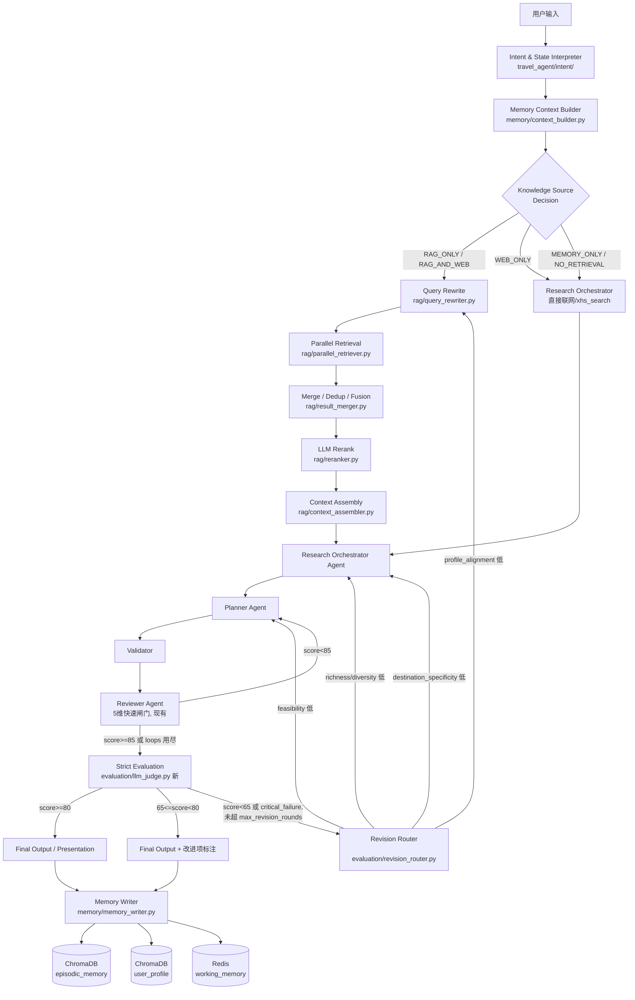

# Round 6 设计文档：小红书 RAG + 分层记忆 + 严格评测

Phase 1 交付物。覆盖需求文档《第六轮优化》的交付物 1-4（现状分析、架构、文件清单、Collection/Memory/Evaluation 设计），
9-16 节给出后续 Phase 的实现级设计，供分阶段开发时直接引用，不需要重新分析现状。

不新增第五个业务 Agent；仍是 Requirement / Research / Planner / Reviewer 四 Agent 架构。

---

## 1. 现状问题分析

### 1.1 记忆系统 (`travel_agent/memory/`)

| 层 | 现状 | 与需求的差距 |
|---|---|---|
| L0 工作记忆 | `working_memory.py`：`AgentState` 的只读视图，无独立存储 | 需求要求 Redis 落盘、24h TTL、`visible_candidates`/`pending_confirmation`/`last_retrieval_summary` 等字段 —— 目前这些字段散落在 `AgentState` 里，没有统一的 `travel:session:{id}:working_memory` key |
| L1 会话记忆 | `conversation_memory.py` 基于 `redis_memory.py`（`REDIS_URL` 配置则用 Redis，否则进程内 dict 兜底），已经是"优雅降级"模式 | 基本可复用，只是 schema（`ConversationMemoryRecord`）偏窄，需要扩展为需求里的 `WorkingMemory` 全字段 |
| L2 情景记忆 | `episodic_memory.py`：**`chromadb` 从未真正接入** —— `__init__` 里 `import chromadb` 成功也只打日志，实际检索永远走 JSONL + Jaccard 标签重叠。`settings.vector_db_path` 默认 `None`，且从未被真正传给任何 client | 需要真正的向量检索；需要 `event_type`/`decisions`/`rejected_options`/`importance_score` 等字段（现有 `TripEpisode` 只有粗粒度 `tags`/`feedback`） |
| L3 用户画像 | `profile_memory.py`：单个 JSON 文件，`upsert()` 对列表字段做去重合并、其余字段整体覆盖 | 没有置信度、证据计数、`SESSION_PREFERENCE/TENTATIVE_PROFILE/STABLE_PROFILE` 区分、没有版本历史 —— 用户说一次就可能被当成永久画像 |

结论：**L2/L3 目前是"看起来像分层记忆，实际是 JSON 文件 + 关键词重叠"**，没有语义检索能力，也没有画像置信度机制。这是本轮要补的地方，而不是推倒重来。

### 1.2 知识库 / RAG

**完全不存在。** `travel_agent/tools/xhs_search.py` 是**实时联网**小红书搜索（通过本机登录 Chrome 的 `opencli xiaohongshu search`），每次现查现搜，不读取任何本地知识库，且 `content`/`tags` 字段固定为空（只有标题/作者/点赞数，见该文件 docstring 里的说明）——**它甚至无法把笔记正文喂给下游**。用户已整理好的小红书攻略目前完全没有入口进入系统。

这与需求文档的 `WEB_ONLY` vs `RAG_ONLY` 区分正好对应：`xhs_search.py` 是 `WEB_ONLY` 工具，本轮要新增的是 `RAG_ONLY`/`RAG_AND_WEB` 的静态知识库路径，两者并存、不互相替代。

### 1.3 评测系统 (`travel_agent/evaluation/`)

- `judge.py`/`schemas.py`：6 维（`intent_understanding`/`destination_relevance`/`activity_matching`/`personalization`/`planning_feasibility`/`response_quality`），加权求和，权重在 `config/evaluation_criteria.yaml`。
- **输入过窄**：`LLMJudge.evaluate(case, agent_response, llm, system_prompt)` 只拿到 `user_request` + `expected_goal` + 一段 `agent_response` 纯文本，**没有结构化 TravelRequirement、没有用户画像、没有情景记忆、没有目的地画像、没有工具证据**——Judge 没法判断"是否符合画像""是否遗漏用户明确要求的活动""是否错误改动了其他日期"。
- **没有硬性扣分**：全靠 LLM 主观打分 + 关键词覆盖率的启发式兜底（`_evaluate_heuristic`），格式完整就容易拿到中等分数。
- **不闭环**：只在 `scripts/eval_llm_judge.py` 手动/离线跑，不在 `graph/workflow.py` 的实时链路里；低分不会触发补充研究或重新规划。
- 现有 `evaluation_cases/*.json`（`feedback`/`destination`/`modification` 三类）与 `EvalCase.category` 的 `Literal` 绑定，需要扩展类别才能覆盖 RAG/memory/richness 用例。

**注意区分**：`agents/reviewer_agent.py` 的 `ReviewReport`（5 维：`time_feasibility`/`route_efficiency`/`preference_match`/`richness`/`budget`）是图内**实时**质量闸门，`planner ↔ reviewer` 循环最多 `settings.max_review_loops`（默认 3）次，`score >= settings.review_pass_score`（默认 85）才放行到 `final_output`。这是"生成中"的快速闸门，天然要便宜、要快。本需求文档的"严格评测"是**生成后**的深度评测，两者定位不同（`evaluation/judge.py` 现有注释已经写明了这一区分），本轮不合并两者，而是新增一个介于两者之间的 `StrictTravelEvaluator`，见第 15 节。

### 1.4 现有可复用的基础设施（不要重复造轮子）

- `travel_agent/tool_runtime/{cache.py,circuit_breaker.py,manager.py,metrics.py}`：进程内 TTL 缓存 + 每工具熔断器 + 超时线程池，`ToolManager.call()` 已经是"缓存→熔断→校验→超时执行→兜底"的标准管线。**并行召回的每一路 retriever 都应该包一层这个,** 而不是新写一套超时/熔断逻辑。
- `travel_agent/config/*.py` 的 config-loader 模式（`@lru_cache` + `(path, mtime)` 失效，YAML 缺失则全部走默认值）：`intent/config.py`、`tool_runtime/config.py`、`evaluation/config.py` 都是同一套写法，`rag/config.py`、`memory` 新配置沿用同一模式。
- `travel_agent/memory/redis_memory.py` 的 `SessionMemory` protocol + Redis/InMemory 双实现：L0/L1 的 Redis 接入直接复用这个，不新写 Redis client。
- `destination_intelligence/service.py`：目的地画像已经存在（`DestinationComplexityAssessment`/`RegionCandidate`），RAG 的 `destination_filters` 改写、Context Assembly 的 `[DESTINATION PROFILE]` 证据块直接读它，不重复实现。

---

## 2. 新架构流程



关键设计取舍：

- **新节点只插入一处**：`strict_evaluation` 挂在现有 `reviewer` 通过之后、`final_output` 之前，复用 `route_after_reviewer`/`route_after_planner` 已经建立的循环边模式（`graph/workflow.py` 已有 `reviewer→planner`、`planner→research_orchestrator` 回边），不改变现有图的整体拓扑。
- **RAG 检索链路完全在 `research_orchestrator` 之前**，Research Agent 收到的是"已经强化过"的 context（含 `[USER PROFILE]`/`[EPISODIC MEMORY]`/`[TRAVEL GUIDE]`/`[LIVE WEB]` 分区文本），而不是原始召回列表。
- **Knowledge Source Decision 不是新 Agent**，是 `rag/source_decider.py` 里的一个规则/轻量分类函数，输入 `intent_result` + `travel_requirement` 关键词特征，输出 `RAG_ONLY|WEB_ONLY|RAG_AND_WEB|MEMORY_ONLY|NO_RETRIEVAL` 五选一，默认规则表 + 可选 LLM 兜底（同 `DestinationIntelligenceService` 的"已知表优先，LLM 兜底"模式）。

---

## 3. 新增/修改文件清单

```
travel_agent/
├── rag/                                    [新增]
│   ├── __init__.py
│   ├── schemas.py                          TravelGuideChunk, RewrittenQuery, RetrievedChunk, RerankedChunk, RetrievalResult
│   ├── config.py                           rag.yaml 加载器（同 evaluation/config.py 模式）
│   ├── source_decider.py                   Knowledge Source Decision
│   ├── query_rewriter.py                   Query Rewrite
│   ├── result_merger.py                    Normalize→Dedup→Fusion Score
│   ├── reranker.py                         LLM Rerank
│   ├── context_assembler.py                Context Assembly
│   ├── chroma_client.py                    ChromaDB PersistentClient 单例 + 3 个 Collection 的 get_or_create
│   │
│   ├── ingestion/                          [新增]
│   │   ├── __init__.py
│   │   ├── document_loader.py              docx/md/txt → 原始文本 + 来源元数据
│   │   ├── cleaner.py                      去重/去营销/去图片描述/时效过滤
│   │   ├── canonicalization.py             地名归一化 (canonical_destination/aliases)
│   │   ├── semantic_chunker.py             按标题/段落语义切块，target/max/overlap tokens 可配
│   │   ├── metadata_extractor.py           LLM 抽取 activity_topics/travel_styles/suitable_for 等
│   │   ├── embedding_writer.py             写入 travel_guides collection，含去重/版本号
│   │   └── ingestion_pipeline.py           串联以上步骤的 CLI 入口
│   │
│   └── retrievers/                         [新增]
│       ├── __init__.py
│       ├── base.py                         BaseRetriever 协议 + 统一 RetrievedChunk 输出
│       ├── dense_retriever.py              travel_guides 向量检索
│       ├── keyword_retriever.py            关键词/子串匹配补充召回（占位 BM25 接口）
│       ├── metadata_retriever.py           destination/topic metadata filter
│       ├── episodic_retriever.py           episodic_memory collection 检索
│       ├── profile_retriever.py            user_profile collection 检索
│       └── parallel_retriever.py           asyncio.gather + 每路走 ToolManager 超时/熔断
│
├── memory/                                 [升级，非重写]
│   ├── schemas.py                          [新增] WorkingMemory / EpisodicMemory(新字段) / UserProfileMemory(新字段)
│   ├── working_memory.py                   [升级] 从"AgentState 只读视图"升级为真正落 Redis 的读写层
│   ├── episodic_memory.py                  [升级] 接入 ChromaDB episodic_memory collection，JSONL 仅作降级
│   ├── profile_memory.py                   [升级] 接入 ChromaDB user_profile collection，JSON 仅作降级；加置信度/状态机
│   ├── context_builder.py                  [新增] Memory Context Builder：按意图动态决定读取哪些层
│   ├── memory_writer.py                    [新增] 统一写入时机判定（第 21 节触发条件）
│   ├── conversation_memory.py               保留，成为 WorkingMemory 的一部分（不删除，向后兼容）
│   ├── redis_memory.py                      保留，working_memory.py 复用其 SessionMemory 实现
│   └── memory_manager.py                    [升级] 门面新增 build_context()，内部调用 context_builder
│
├── evaluation/                              [升级]
│   ├── schemas.py                           [升级] JudgeDimensionScores → 8 维；新增 TravelEvaluationResult
│   ├── case_schema.py                       [升级] EvalCase.category 扩展 rag/memory/personalization/richness
│   ├── config.py                            [升级] 加载 8 维权重 + hard_penalties + max_revision_rounds
│   ├── judge.py                             [升级] 输入扩展为完整上下文；沿用 LLM/heuristic 双路径
│   ├── llm_judge.py                         [新增] StrictTravelEvaluator：judge.py 的严格版本，走 TravelEvaluationResult
│   ├── penalty_rules.py                     [新增] hard_penalties 规则表 + 触发检测
│   ├── revision_router.py                   [新增] 低分/critical_failure → 路由到哪个节点
│   └── report_generator.py                  [新增] 逐项评分报告（人类可读 + trace_id 关联）
│
├── graph/
│   ├── nodes.py                             [升级] 新增 strict_evaluation_node；requirement/research/planner/reviewer 改为读 MemoryContext
│   ├── workflow.py                          [升级] 插入 strict_evaluation 节点与回边
│   └── state.py                             [升级] AgentState 增加 trace_id / retrieval_summary 字段
│
├── api/
│   └── knowledge.py                         [新增] /knowledge/ingest, /knowledge/search, /memory/*, /evaluation/travel, /evaluation/report/{trace_id}
│
config/
├── rag.yaml                                 [新增] embedding_model, top_k, 阈值, 融合权重
├── memory.yaml                              [新增] max_working_messages, episodic_top_k, profile_top_k, TTL
└── evaluation_criteria.yaml                 [升级] 8 维权重 + hard_penalties + max_revision_rounds

evaluation_cases/
├── rag_retrieval_cases.jsonl                [新增]
├── memory_cases.jsonl                       [新增]
├── personalization_cases.jsonl              [新增]
├── richness_cases.jsonl                     [新增]
├── modification_cases.json                   保留
├── destination_cases.json                    保留
└── feedback_cases.json                       保留

scripts/
├── ingest_travel_guides.py                  [新增] ingestion_pipeline 的 CLI 包装
└── eval_rag_retrieval.py                    [新增] Recall@K/Precision@K/MRR/NDCG

docker-compose.yml                            [新增，可选] 仅 Redis（ChromaDB 默认走本地 PersistentClient，无需容器）
requirements.txt                              [升级] + chromadb
```

不改动：`agents/{requirement_agent,research_agent,planner_agent,reviewer_agent}.py` 的核心逻辑（只改它们读取 context 的入口，见第 14 节），`tool_runtime/*`、`destination_intelligence/*`、`intent/*`、`skills/*`、`tools/*` 原样复用。

---

## 4. ChromaDB Collection 设计

统一走 `rag/chroma_client.py` 里的单例：

```python
import chromadb
_client = chromadb.PersistentClient(path=settings.vector_db_path)  # 默认 ./data/chroma
```

不引入 ChromaDB Server / Docker —— 本地嵌入式持久化客户端已满足单机开发+小规模生产，符合项目一贯"最简单能优雅降级的方案"风格；`rag.yaml` 里预留 `chroma_server_url` 字段，如未来要多进程共享再切换到 HttpClient。

三个 Collection，**不混用**：

| Collection | 用途 | Embedding | 典型 metadata filter |
|---|---|---|---|
| `travel_guides` | 小红书攻略切块 | `rag.embedding_model` | `canonical_destination`, `activity_topics`, `guide_type` |
| `episodic_memory` | 压缩后的历史旅行事件 | 同上 | `user_id`, `event_type`, `destinations` |
| `user_profile` | 长期偏好陈述 | 同上 | `user_id`, `preference_dimension`, `status` |

Embedding 模型默认值（`rag.yaml: embedding_model`）：**Chroma 内置 `ONNXMiniLM_L6_V2`**（本地 ONNX，免 API Key，离线可跑）——与项目现有"优先离线可测"的取向一致（真实 Kimi/DeepSeek API 慢，见既往 memory）。配置化，可切换为任意 API embedding（如接入 OpenAI-compatible embedding endpoint），字段里同时存 `embedding_model_version` 供缓存失效判断（见需求文档第三十三节）。

`travel_guides` 文档 schema 直接采用需求文档第六节的 `TravelGuideChunk`（原样落地到 `rag/schemas.py`），新增字段：

```python
canonical_destination: str | None   # 归一化后的目的地（见 ingestion/canonicalization.py）
canonical_region: str | None
canonical_place_name: str | None
aliases: list[str] = []
```

`activity_topics` 不设全局枚举，允许 LLM 在 `metadata_extractor.py` 动态生成新词——落 Chroma 时仍必须是标量/字符串列表（Chroma metadata 不支持嵌套 list，需要用 `"|".join(topics)` 存一份可 filter 的扁平字符串,并把结构化版本存进 `content`/`document` 侧的 JSON 里，检索时反序列化）。

---

## 5. Redis 工作记忆设计

延续 `redis_memory.py` 现有的 `SessionMemory` protocol（Redis 可用则用，否则进程内 dict 兜底），**不新增第二套 Redis 封装**。

Key：`travel:session:{session_id}:working_memory`（新前缀，区别于现有 `travel_agent:session:` 前缀的旧版 `ConversationMemoryRecord`，保证迁移期两者互不干扰）。

TTL：24h（`memory.yaml: working_memory_ttl_seconds`，独立于 `settings.redis_ttl_seconds` 现有的 7 天默认——两者语义不同，working memory 就该短）。

`WorkingMemory` schema 按需求文档第十六节原样落地到 `memory/schemas.py`，`recent_messages` 限制 `memory.yaml: max_working_messages`（默认 12），超出先摘要再截断（复用 Planner/Research 已有的"控制 prompt 长度"惯例，摘要走同一个 `get_llm(role=..., tier="fast")`）。

现有 `ConversationMemoryRecord`（L1）不删除：`WorkingMemory` 是它的超集，`working_memory.py` 内部把 `original_request/confirmed_requirement/user_choices/rejected_options` 映射进新 schema 对应字段，旧代码路径（`memory_manager.update_memory` 里 `original_request=...` 等具名参数）保持兼容。

---

## 6. 情景记忆设计

Collection: `episodic_memory`。Schema 采用需求文档第十七节的 `EpisodicMemory`（`event_type`/`event_summary`/`destinations`/`entities`/`user_feedback`/`decisions`/`rejected_options`/`importance_score`），作为现有 `TripEpisode` 的**扩展**而非替换：

- `TripEpisode` 现有字段（`selected_experiences`/`final_plan_summary`/`budget_difference`）映射进新 schema 的 `decisions`/自由 metadata。
- `episodic_memory.py::add_episode()` 保持函数签名，内部改为：算 `importance_score` → 达到阈值才写 Chroma（否则仍写 JSONL，保底不丢数据，`RAG_DEGRADED` 场景可以从 JSONL 重建）。
- 写入触发条件严格按需求文档第二十一节（用户明确反馈/确认需求/确认地区/拒绝候选/行程完成/局部重规划完成）——即 `graph/nodes.py` 里已经调用 `_memory_manager.update_memory(...)` 的那几处调用点（第 203、524 行），只是把"总是写"改成"满足条件才写"+"改用新 schema"。

检索：`episodic_retriever.py` 用向量检索替换 Jaccard，但保留 Jaccard 作为 `RAG_DEGRADED`（Chroma 不可用）时的降级路径——两套实现共存于 `episodic_memory.py`，和现有 `redis_memory.py` 的降级模式完全一致的写法。

---

## 7. 用户画像设计

Collection: `user_profile`。这是本轮记忆系统里变化最大的一块：现有 `profile_memory.py` 是"一个用户一条 JSON 记录、字段覆盖式更新"，需求要求"多条带置信度的陈述、可回滚、区分本次偏好/长期画像"。

Schema 采用需求文档第十八节 `UserProfileMemory`（`profile_id`/`statement`/`preference_dimension`/`confidence`/`evidence_count`/`source_session_ids`/`status`），每条画像陈述是 Collection 里独立一条记录，而不是一个大 JSON 对象里的一个字段。

状态机（第十九节）：

```
新证据 → 与已有画像（向量检索最相似的已有 statement）比较
       → 语义支持 (cosine 高且不矛盾) / 语义冲突 (llm 判断矛盾) / 独立新陈述
       → 支持: evidence_count += 1, confidence 提升, status 可能从 TENTATIVE_PROFILE 升级到 STABLE_PROFILE（evidence_count >= 阈值）
       → 冲突: 保留旧记录（status 不变或降 confidence），新记录单独写入，status=SESSION_PREFERENCE，不覆盖
       → 新陈述: 按语气强度判断初始 status（"这次想..."→SESSION_PREFERENCE；"我一直/每次都..."→TENTATIVE_PROFILE，需二次印证才转 STABLE）
```

`profile_memory.py::upsert()` 保留原签名作为向后兼容的"批量字段"入口，内部改为对每个非空字段调用新的 `add_or_reinforce_statement()`；`ProfileMemory.get(user_id)` 改为聚合 `status=STABLE_PROFILE`（+ 高置信度 `TENTATIVE`）的陈述，拼回一个近似原 `UserProfile` 形状的对象，保证 `agents/*.py` 里现有读取代码不用改。

---

## 8. 小红书攻略入库流程设计

```
document_loader.py     : .docx (python-docx，复用 anthropic-skills:docx 同款库) / .md / .txt
                          → List[RawDocument{text, source_title, source_url?, source_author?, publish_time?}]
cleaner.py              : 正则+关键词规则去广告/纯图片描述("[图片]"这类占位符)/去重复笔记(simhash)
canonicalization.py     : 地名词典 + LLM 兜底，佩尼达岛/帕尼达岛/Nusa Penida → canonical_place_name
semantic_chunker.py     : 优先按 Markdown/Word 标题层级切；无标题结构则按段落 + LLM 判断"这几段是否讲同一件事"合并，
                          target 400 / max 650 / overlap 80 tokens（config/rag.yaml: chunking.*）
metadata_extractor.py   : LLM 结构化输出 TravelGuideChunk 除 id/content/embedding 外的所有字段
embedding_writer.py     : 计算 embedding，写入 travel_guides；写入前用 (parent_document_id, chunk_index) 或
                          content hash 判重，已存在则更新而非重复插入（"去重和版本管理"）
ingestion_pipeline.py   : 串联以上 5 步，暴露 ingest_file(path) -> IngestionReport{chunks_written, duplicates_skipped, errors}
```

`scripts/ingest_travel_guides.py` 是 CLI 包装：`python scripts/ingest_travel_guides.py <文件或目录>`。

**阻塞项**：本阶段设计不依赖具体文件内容，但 Phase 2 编码验证需要至少 1 份真实（或示例）小红书攻略文件。已与用户确认：真实文件稍后提供，Phase 2 先用少量示例数据（乌布/东京，覆盖需求文档第二十九节的验收场景）验证流水线，真实文件到位后重跑一次 ingestion 并做人工抽查。

---

## 9-14. RAG 检索链路（Phase 3 实现细则）

- **Query Rewrite** (`rag/query_rewriter.py`)：输入/输出 schema 与需求文档第十节完全一致；LLM 结构化输出走 `get_llm(role="research", tier="fast")` + `method="function_calling"`（沿用 `requirement_agent.py`/`destination_intelligence/service.py` 已验证的 DeepSeek 兼容写法），无 LLM 时退化为"原句当 semantic_query + 简单分词当 keyword_queries"。
- **Parallel Retrieval** (`rag/retrievers/parallel_retriever.py`)：`asyncio.gather(..., return_exceptions=True)`，每一路内部调用 `get_tool_manager().call(retriever.retrieve, kwargs, tool_name="rag_dense"/"rag_keyword"/"rag_episodic"/"rag_profile", timeout=..., cache_ttl=...)`——直接复用现有 `ToolManager`，不新写超时/熔断/缓存逻辑，只需在 `config/tool_runtime.yaml` 里给这 4 个新 tool_name 加配置段。这是本设计里最重要的"复用而非重造"决策。
- **Merge/Dedup** (`rag/result_merger.py`)：去重键优先级 `parent_document_id` > `canonical_place_name`+内容相似度 > `source_url`；融合分数公式与权重直接用需求文档第十三节给的默认值，写入 `rag.yaml`，评测后再调。
- **LLM Rerank** (`rag/reranker.py`)：`RerankInput`/`RerankedChunk` 照搬需求文档第十四节；无 LLM 时退化为按 fusion score 直接截断 top-K（不做"是否重复/是否可执行"的语义判断）。
- **Context Assembly** (`rag/context_assembler.py`)：输出四分区文本（`[USER PROFILE]`/`[EPISODIC MEMORY]`/`[TRAVEL GUIDE]`/`[LIVE WEB]`），每条证据保留 `source_id`/`source_type`/`relevance`/`freshness`——这是喂给 Research Orchestrator Agent 的最终产物，Agent 本身的 prompt 组装逻辑不用大改，只是把"直接塞原始搜索结果"换成"读这一段组装好的 context"。

---

## 15. 严格评测设计（Phase 6 实现细则）

`evaluation/llm_judge.py::StrictTravelEvaluator`（新，区别于现有 `judge.py::LLMJudge`，两者共存——`LLMJudge` 继续服务 `scripts/eval_llm_judge.py` 现有的"人工用例 vs agent 回复"场景；`StrictTravelEvaluator` 服务图内闭环，输入更重）：

输入 = 需求文档第二十三节列的全部 9 项（原始需求/结构化 TravelRequirement/画像/情景记忆/目的地画像/候选活动/最终行程/工具证据/本轮反馈），全部来自 `AgentState` 已有字段 + `MemoryContext`，不需要额外查询。

维度：8 维，权重取需求文档第二十四节默认值（20/15/15/15/10/15/5/5=100），`hard_penalties` 表原样落地到 `evaluation/penalty_rules.py`，`TravelEvaluationResult` schema 原样落地到 `evaluation/schemas.py`。

闭环路由 (`evaluation/revision_router.py`)：

```
score >= 80                          → route="final_output"
65 <= score < 80                     → route="final_output_with_notes"（improvement_actions 附加到回复末尾）
score < 65 或 critical_failures 非空  → route 由 should_research_more/should_replan/suggested_research_directions 决定：
    richness/diversity 主因      → route="research_orchestrator"（补充候选）
    profile_alignment 主因       → route="query_rewriter"（重建 Query，带上 negative_preferences）
    destination_specificity 主因 → route="research_orchestrator"（连带触发 destination_intelligence 重新 profile）
    feasibility 主因             → route="planner"
超过 max_revision_rounds（默认 2）→ 强制 route="final_output_with_notes"，避免死循环
```

`graph/nodes.py` 新增 `strict_evaluation_node`：读 `state["revision_round"]`（新字段，默认 0），调用 `StrictTravelEvaluator`，写回 `state["strict_evaluation"]`，`route_after_strict_evaluation()` 按上表返回下一节点名；`revision_round += 1` 在每次非 final 路由时递增。

---

## 16. Memory Context Builder 设计（Phase 4/5 衔接点）

`memory/context_builder.py::build_context(state, intent) -> MemoryContext`，按需求文档第二十节的三个例子做成一张"意图类别 → 需要哪些层"的规则表（不是每次全量拉取）：

```python
_CONTEXT_PLAN = {
    "weather_query":      {"working": True, "episodic": False, "profile": False, "rejected": False},
    "replan_day":         {"working": True, "episodic": True,  "profile": True,  "rejected": True},
    "new_trip":           {"working": False,"episodic": True,  "profile": True,  "rejected": False},
    # 默认兜底：working+profile，不查 episodic（避免每个查询都做一次向量检索）
}
```

`agents/{requirement_agent,research_agent,planner_agent}.py` 的改动仅限于：函数签名新增一个可选 `memory_context: MemoryContext | None = None` 参数，prompt 拼装时若非空则插入对应分区文本；不改动这几个 Agent 的核心决策逻辑。这是"Phase 5：Agent 接入"要做的全部事情——四个 Agent 都读同一个 `MemoryContext`，不再各自查不同版本的画像/历史（对应需求文档三十六节 Phase 5 的约束）。

---

## 17. 配置与依赖变更

`requirements.txt` 新增一行：`chromadb>=0.5.0`（本地 PersistentClient 模式无需额外系统依赖，纯 Python + onnxruntime，Windows 下 `pip install` 即可，不需要 Docker）。

`config/rag.yaml`（新增）、`config/memory.yaml`（新增）示例值直接采用需求文档第十二/二十节给出的默认值；`config/evaluation_criteria.yaml` 升级为 8 维 + `hard_penalties` + `max_revision_rounds`（保留现有 `weights` 键名风格）。

不引入 docker-compose 强依赖：Redis 沿用现有"配置了 `REDIS_URL` 就用，没配就进程内兜底"的模式；ChromaDB 走嵌入式 PersistentClient。README 会补一节"如何本地起 Redis（可选，docker run 一行命令）"，不强制要求。

---

## 18. 分阶段实施顺序（与需求文档三十六节对齐）

| Phase | 内容 | 产出可独立验收 |
|---|---|---|
| 1（本文档） | 现状分析 + 文件级设计 | 本文档 |
| 2 | 攻略入库：`rag/ingestion/*` + `rag/schemas.py` + `rag/chroma_client.py` | 用示例攻略跑通 `ingest_file()`，`travel_guides` collection 有数据可查 |
| 3 | RAG 检索链路：`source_decider/query_rewriter/retrievers/result_merger/reranker/context_assembler` | 单元测试 + 一条端到端"乌布瑜伽"查询能召回示例攻略 |
| 4 | 分层记忆：`memory/schemas.py` + working/episodic/profile 升级 + `context_builder.py` | 单元测试：写入→按 user_id 检索→置信度状态机流转 |
| 5 | Agent 接入：四个 Agent 读取统一 `MemoryContext` | 现有 offline pytest 套件不回归 + 新增用例验证画像/情景生效 |
| 6 | 严格评测：`evaluation/llm_judge.py` + `penalty_rules.py` + `revision_router.py` + graph 接入 | 用一份"重复寺庙/缺瑜伽/活动稀疏"的坏方案跑评测，验证低分+扣分原因+自动路由 |
| 7 | 测试与性能：单测/集成/检索质量评测/端到端 + README + 性能报告 | 全量 pytest 通过 + `scripts/eval_rag_retrieval.py` 报告 |

Phase 2 编码前需要用户提供的真实小红书攻略文件（当前用示例数据占位）。每个 Phase 结束后单独确认再进入下一个，避免一次性大改动难以回滚。
