# PRD v2（自用 + 作品集）

> 导出自 Notion：https://app.notion.com/p/3fd2c86edbe481d3b46bd6f54ac65783 （2026-10-18 13:43 UTC+8）。图片位于 prototypes/。

> 📌 **定位**：个人旅行规划 Agent。**不上线公开**，只做两件事：① 自己规划真实旅行；② 作品集 / 面试演示。**当前范围：国内优先**，出境行程暂缓（见第 17 节）。
> **已确认的环境**：个人主体小程序（不能用 web-view）；后端部署在腾讯云上海（Ubuntu，6 个容器：api / worker / postgres / redis / chroma / gateway）；国内地点、路线、天气已接入**高德 Web 服务**；LLM 用 DeepSeek，Kimi 兜底。
> **事实来源**：已实现的能力和实现方式以 [行迹微信小程序第二版技术与产品说明](https://app.notion.com/p/3fd2c86edbe480a3ab48c13331ebf33e) 为准；本页只写产品决策。双方有冲突的地方见第 2 节「待确认取舍」（#1、#5 已定）。其他原文档：[prd](https://app.notion.com/p/3a02c86edbe480c8814acce88b8695db)、[技术亮点介绍](https://app.notion.com/p/3a72c86edbe48053a763e67526355e8c)、[流程图](https://app.notion.com/p/3a62c86edbe4801c9e07e4b0e4b9d87b)。标「推断」的内容未经证实。

## 范围决定（2026-10-18）
> ✅ **Zhihao 决定：本版 P0 全做，P1 暂缓。**

**P0（本版范围）**
1. 主流程改造：一句话 → 偏好轻确认 → 后台规划 → 超容量时景点确认 → 草稿
2. 地图优先行程页 + 撤销
3. 加点并重算当天
4. 北京 top 20 玩法卡
5. 质量：10 条测试用例达 85+、合并 Reviewer 层、缩短 Deep Path 超时、失败不显示假「规划完成」
6. 高德路线接入 + 降级态
7. 保存、历史记录、我的行程、离线缓存
8. 手机稳定访问：HTTPS、自有 openid 登录、健康检查
9. 小红书手动粘贴导入
10. Agent 透视
**P1（暂缓）**：导出图片、门票预约跳转与提醒、小红书在线搜索 + 再查最新、小红书每日爬取、长尾玩法卡、「今天」视图、我的偏好页、选酒店 / 选餐厅、清空历史与删除偏好。

## 1. 目标与成功标准

| 场景 | 成功标准 | 怎么测 |
|---|---|---|
| 自用 | 一次真实国内旅行，从一句话到可执行行程 **\< 15 分钟**，手动修正 **≤ 5 处**（N=5 是建议值）；**不开电脑**也能在自己手机上用 | 计时 + 手动编辑次数；电脑关机后在手机体验版上走完整个流程 |
| 面试 | **3 分钟演示**，讲清楚对话流畅、改动可解释（Agent 透视） | 按第 12 节的脚本彩排 |
| 玩法卡（建议） | 每次行程中被打开过玩法卡的节点占比、「再查最新」使用率（P1，本版不计）；自测时，规划和出行过程中离开小程序去小红书 / 百度搜索的次数明显减少 | 埋点统计 + 自己记录离开 App 的次数 |
| 质量底线 | 展示给用户的行程：Reviewer ≥ 85（现有通过线），或者明确显示「质量待改进」并附问题列表 | 现在一次真实完整计划大约 49 分，这是第一优先要解决的问题 |

## 2. 待确认取舍（第二版说明 vs 本 PRD）
#1、#5 已由 Zhihao 决定；#2、#3、#4、#6 暂按「建议」一列执行，等确认。**P0 / P1 范围 ✅ 已决定（2026-10-18）**：P0 全做，P1 暂缓，见「范围决定」。

| # | 议题 | 第二版说明 | 本 PRD | 建议与理由 |
|---|---|---|---|---|
| 1 | 主流程 ✅ 已决定 | 需求确认 → 研究 → 候选选择 → 规划，都是固定暂停点 | 先出草稿，再改 | **混合方案**：一句话 → **轻量偏好确认**（必经，3–5 个按目的地挑选的问题，用 chips 作答，L3 预填）→ **景点确认**（只在候选塞不下或用户主动要求时出现）→ 草稿 → 对话 / 地图修改。理由：不同人对同一个目的地偏好差别很大（如巴厘岛：喜欢瑜伽、冲浪，不想爬火山），先确认偏好可以避免白生成。规则见 5.1 |
| 2 | 界面 | 首页主视觉 + 快捷入口；对话 / 候选 / 行程三个标签；阶段标签 | 一个地图优先的行程页 + 底部对话栏 | **按 PRD 来**：同一份行程拆在三个地方，正是第 11 节截图暴露的问题。快捷提示词保留在空态 |
| 3 | 发布范围 | 正式发布清单：备案域名、微信登录、资源归属校验、审核、多用户越权测试；目标人群包括「小规模同行群体」 | 不上线，只供本人使用 | **只做自用必需的部分**：一个 HTTPS 公网入口 + 自用鉴权（wx.login 后只放行自己的 openid）+ 监控。审核、多用户和同行功能不做。过渡方案：体验版在手机上打开「开发调试」可以跳过域名校验 \{r(14)\}，但网关目前只监听回环地址，仍然需要一个公网入口 |
| 4 | 出境 | Photon / OpenStreetMap + Open-Meteo 降级已实现；建议后续接入海外路线服务 | 暂缓出境 | **保留现有降级代码，不再投入**；界面上不主动提供出境入口，或标注「实验」。理由：后端在大陆，Google 不可用，海外路线没有可行方案 |
| 5 | 小红书 ✅ 已决定（用户方案） | 把小红书作为搜索源，并建设大型个人知识库 | 只做手动粘贴 | **按用户方案执行，分两条线**：(A) **在线搜索**：在小程序原生表单里填手机号 + 短信验证码，后端用他的账号登录，针对本次行程做少量搜索；(B) **每日入库**：定时抓取一部分内容进入 RAG 知识库。手动粘贴导入保留为零风险兜底。规则见 10.1 |
| 6 | 国内数据源 | 高德（已实现、已验证） | 上一版写的是腾讯位置服务 | **按事实改为高德**；腾讯只作为备选，坐标同样是 GCJ-02 |

## 3. 现状（来自第二版说明，视为事实）

| 能力 | 状态 | 备注 |
|---|---|---|
| 多轮需求收集、区域确认（Requirement Agent） | 已实现并验证 | 缺字段时在 clarification 暂停 |
| 异步研究（Research Orchestrator + RQ Worker）、`/api/research/status` 轮询、重试和陈旧任务处理 | 已实现 | task_runs 记录工具进度 |
| 高德地点、路线、天气 + 每秒 2 次限速 + 区域校验 + 旅游类型过滤 | 国内已验证 | 最近一次发布后 QPS 错误为 0 |
| 确定性排程 Planner + 局部重规划（只重建目标日期或目标部分） | 已实现 | — |
| Validator → TripCraft 指标 → Reviewer（通过线 85）→ 严格评估，两个循环分别计数 | 已实现 | 真实计划大约 49 分 |
| MultiSignalIntentInterpreter（Fast / Deep 两条路径，规则 + 本地 n-gram 相似度 + LLM 融合）+ Workflow Validator + Execution Planner + Result Aggregator（生成保留和变更 diff） | 已实现 | Validator 会检查是否触碰「锁定约束」 |
| 记忆 L0 checkpoint / L1 Redis 工作记忆 / L2 情景 / L3 画像（置信度状态机）+ Memory Context Builder 按意图读取 | 已实现 | — |
| RAG：Source Decider + 五路检索 + 融合 + 重排 + 四段上下文 | 已实现 | 8 个来源、307 个攻略块 |
| 行程工作区 API：days、routes、places/autocomplete、preview-insert、apply-patch（plan_version 乐观锁）、rollback-patch、hotel-candidates/select | 已实现（后端） | **这是地图交互的现成后端** |
| 会话恢复 / 新建行程（session_id + PostgreSQL checkpointer） | 已实现 | — |
| 小红书 / Agent Reach | 接口保留，云端不可用 | 失败时如实返回状态 |
| 签证 / 机票 / 酒店实时价格 | 占位 / 估算 | — |
| 手机真机访问 | 未完成 | 网关只监听回环地址，目前只能通过开发者工具 + SSH 隧道访问；API 曾出现 unhealthy → 502，根因未知 |

## 4. 核心改动一览

| 维度 | 现状 | v2 目标 |
|---|---|---|
| 主流程 | 固定暂停点组成的瀑布式流程 | 一句话 → 轻量偏好确认 → （条件式）景点确认 → 草稿 → 修改（取舍 1） |
| 入口信息 | 多轮补全 8 类字段 | 一句话抽取 **目的地、日期、人数、预算**  • 3–5 个偏好 chips（L3 预填），不出现长表单 |
| 可行性（天气 / 安全 / 客流） | 研究阶段输出 | 行程顶部的**风险横幅**，不拦流程 |
| 酒店 / 餐厅 | 候选和选择流程 | 行程上的**可选动作**（复用 hotel-candidates/select） |
| 数据 | 后端已有工作区 + patch；前端仍是三处展示 | **唯一数据源**：对话、地图、列表都通过 apply-patch 修改同一份行程 |
| 界面 | 三个标签 + 时间线 | 一个地图优先的行程页（见取舍 2） |
| 知识库 | 攻略 RAG（8 个来源）+ 高德 POI | 国内「目的地包」：高德 POI + **个人小红书知识库**（在线搜索 + 每日入库 + 粘贴兜底）+ 现有攻略 RAG（+ 可选搜索 API） |

## 5. 新用户流程
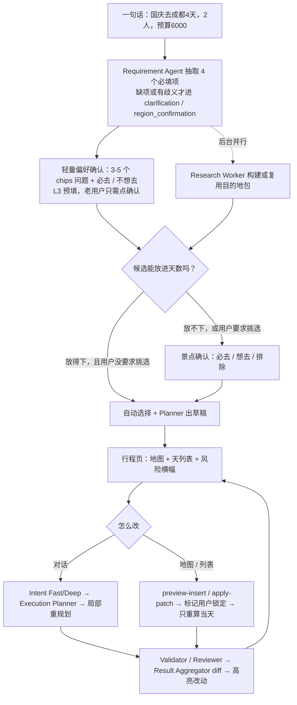

### 5.1 偏好确认与景点确认规则

| 项 | 规则 |
|---|---|
| 问题数量和来源 | 每次 3–5 个，按目的地挑选（海岛问活动类型、城市问热度、带老人小孩问节奏）。候选维度：活动类型、节奏、作息、热度、预算分配；**必去**、**不想去**两项固定出现 |
| 作答形式 | chips 单选 / 多选 + 可选的一行自由输入；不用长表单；整页一屏放下 |
| L3 预填 | STABLE_PROFILE 默认选中，TENTATIVE 显示为「上次选过」；老用户可以「全部沿用 → 确认」一步完成。修改会写回 L3（沿用置信度状态机） |
| 研究并行 | 偏好确认期间，研究 Worker 已经在后台构建目的地包；用户确认后只做排序和筛选，不必从头研究 |
| 景点确认触发条件 | ①（必去 + 高分候选）的预计时长超过天数容量；或 ② 用户点「我想自己挑」。其余情况自动选择，直接出草稿 |
| 图节点映射 | user_confirmation 改为偏好确认页（必经）；user_selection 变成条件节点；clarification / region_confirmation 不变 |

## 6. 地图交互需求（主行程页，地图优先）
**布局**：上半屏是原生 `map`，下方是三档底部抽屉（收起只显示天 Tab / 半屏 / 全屏列表），最底部是固定的对话输入栏。地图使用腾讯底图，高德返回的坐标同为 GCJ-02 \[1\]，**不需要转换**。

| 功能 | 需求 | 依据 / 复用 |
|---|---|---|
| 天切换 | 天 Tab；只画当天路线，视野自动包含当天所有点 | `include-points` \[1\]；`GET /trips/{id}/days/{day}/routes` |
| 标记点 | 按顺序编号；景点 / 酒店 / 餐厅样式不同；锁定的点加锁角标；冲突点标红 | `markers` \[1\] |
| 路线 | 每天一条 polyline，按交通方式分色；显示当天总交通时间和步行距离 | `polyline`  • `colorList` \[1\]；路径点来自高德路径规划 \[6\] |
| 点卡片 | 地点卡与玩法卡合并：半屏显示基础信息 + 操作（来源含新鲜度、替换、删除、移到第 N 天、锁定、导航），上拉全屏为**玩法卡**（见第 8 节） | `bind:markertap`；完整卡片放在抽屉里 \[1\] |
| 加点 | 搜索（`/places/autocomplete`）或点地图 / 底图 POI → 选第几天 → `preview-insert` 展示当天变化和冲突 → 确认后 `apply-patch` | `bind:tap`（基础库 2.9.0+）/ `bind:poitap` \[1\] |
| 排序 | 拖动排序 → 预览 → 应用；产生冲突时标红，可以「恢复」（`rollback-patch`） |  |
| 导航 | 调起外部地图 App | `wx.openLocation` \[2\] |
| 对话联动 | 回复只写一两句，地图和列表高亮 Result Aggregator 的变更 diff，不重发整份行程 |  |
| 状态 | 表现 |
|---|---|
| 空态 | 只在这时出现主视觉和快捷提示词 |
| 偏好确认 | chips 页（L3 预填）；底部显示「正在准备目的地资料…」研究进度 |
| 加载 | 骨架行程按天流式填入；进度来自 `/api/research/status` |
| 冲突 | 节点标红并写明原因，操作：接受 / 换一个 / 移到别的天 |
| 工具失败 | 只显示**一条**横幅 + 重试按钮；估算的路段用「≈」或虚线轻标 |
| 配额 / 限流 | 高德当天配额用完时提示「已使用缓存 / 估算」 |
| 质量未达标 | \< 85：显示「草稿 · 质量 62/100」+ 问题列表 +「自动修正」；不写「规划完成」 |
| 版本冲突 | apply-patch 因 plan_version 不一致被拒绝时，提示「行程已更新」并刷新 |

## 7. 手动修改与 Agent 协同规则

| 规则 | 说明 | 状态 |
|---|---|---|
| 唯一数据源 | `Trip → Day[] → Node[]`；所有入口都走 apply-patch，用 plan_version 乐观锁 | 后端已实现 |
| 撤销 | rollback-patch | 后端已实现 |
| 用户锁定 | 手动添加、移动、替换的节点自动标记 `locked_by_user`；Agent 重排时不改动它们的日期、顺序和时间 | 部分实现：Workflow Validator 已检查锁定约束；手动编辑后自动加锁还没确认（推断） |
| 告知 Agent | 每次手动 patch 写入 L1 工作记忆（`last_user_edits`），下一轮对话 Requirement 和 Planner 都能看到 | 未开始 |
| 重算范围 | 默认只重算当天；跨天移动重算两天；用户明确要求时才全局重排，并且保留锁定节点 | 局部重规划已实现 |
| 冲突处理 | 只给建议，不自动应用；用户的明确操作优先 | — |

## 8. 玩法卡（P0，新增）
**问题**：行程节点只写着「故宫」这样的地名，用户还得去小红书或百度查怎么玩，于是离开了小程序。
**方案**：每个 POI 节点都能打开一张玩法卡。**地点卡与玩法卡合并为一张卡**（UX 评审，2026-10-18）：半屏显示基础信息 + 操作，上拉到全屏即为玩法卡。

| 模块 | 内容 | 数据要求 |
|---|---|---|
| 为什么给你排它 | 结合他的偏好和记忆说理由（例如「你说喜欢古建筑，L3：节奏松弛」），不写通用简介 | 来自 L3 / 本次偏好确认 + Planner 的排程理由 |
| 推荐玩法 | 可以照着走的馆内路线，例如 午门 → 太和殿 → 乾清宫 → 御花园 → 神武门，约 3 小时；再按 L3 兴趣给出分支（珍宝馆、角楼） | RAG 中的 play_card 结构化字段 |
| 必看 / 可跳过 | 两张短列表 | 同上 |
| 避坑 | 每条都带来源和日期；**预约、闭馆、票价这类硬信息只取自高德或官方渠道，不让 LLM 生成** | 高德 POI 营业信息（具体有哪些字段待核实，推断）+ 官方渠道；缺失时显示「未核实」 |
| 出来之后 | 从哪个出口出来，并链接到下一站（复用当天路线） | 行程数据 + 高德路线 |

**操作**
- **展开到行程**：把推荐玩法拆成按时间对齐的子节点，写回同一份行程（走 apply-patch），「今天」视图会用到
- **再查最新**：在小程序内针对这个 POI 做一次小红书在线搜索（按已决定的方案 (A)，见 10.1），结果更新到卡片并注明时间
- **看原笔记**：复制原笔记链接（小程序打不开小红书 App）
- **去预约 / 已约**：见 8.1
**内容生产**（放在现有框架里）
- RAG 里给每个 POI 增加结构化字段 `play_card`（why / route / branches / must_see / skippable / pitfalls\[source, date\] / exit / updated_at）
- LLM 把 3–5 篇小红书笔记总结成上述结构化字段，并保留来源链接；硬信息用工具数据覆盖
- 每个城市预先计算热门 20–30 个 POI（**先做北京 top 20**）；其余的长尾 POI 在首次打开时生成，然后缓存
- 卡片上显示「更新于 X」；超过新鲜度阈值时提示「再查最新」
- 「为什么给你排它」按用户实时生成（很轻量），其余字段按 POI 缓存
**成功指标（建议）**：见第 1 节的「玩法卡」一行。

### 8.1 门票预约（P1，2026-10-18 由 P0 调整）
- **去预约**：需要预约的 POI，玩法卡上显示「去预约」按钮，跳转到**官方预约小程序**；小程序内不购票、不代约
- **预约窗口提醒**：行程顶部显示预约提醒，例如「故宫：参观前 7 日 20:00 开售，周一闭馆（法定节假日除外）」\[20\]；「国家博物馆：可提前 7 日内预约，每日 17:00 放票，周一闭馆」\[22\]。规则作为硬信息存储，带来源和核实日期，不让 LLM 生成
- **已约**：用户手动标记「已约」（可以填入馆时段）；没约的节点在开售时间前持续提醒
- **已核实的官方渠道**：故宫 →「故宫博物院」小程序（官网说明这是唯一官方渠道）\[20\]\[21\]；国家博物馆 →「国家博物馆官方预约」小程序（官网另提供网页预约）\[22\]\[23\]。其他景点的官方渠道**待核实**，逐个确认后再加入
- **跳转约束（官方文档）**：`wx.navigateToMiniProgram` 只能由用户点击触发，跳转前微信会弹窗让用户确认 \[18\]；自 2020-04-24 起不需要声明跳转名单，也不限跳转数量 \[19\]。API 文档里没有写个人主体的限制（社区回复称不同主体之间可以跳转）\[18\]\[19\]。需要目标小程序的 **appId**（或通过「小程序菜单 → 复制链接」得到的 shortLink，基础库 2.18.1+）\[18\]；故宫和国博的 appId **待核实**，要实测。不能做「集中设立跳转」的导流入口 \[24\]；自用版不受影响。半屏打开（embeddedMiniProgram）没有核实，不采用
- **兜底**：跳转失败或 appId 未知时，显示「复制小程序名称 + 预约说明」（例如「在微信搜索『故宫博物院』小程序 → 门票预约」）

## 9. 保存、离线、导出与历史记录

| 需求 | 规则 | 优先级 / 理由 |
|---|---|---|
| **历史记录（我的行程）** | 每次规划都是独立的 trip（北京和成都互不覆盖）。入口在行程页**左上角**「我的行程」，也就是信息架构里原有的「我的行程」入口。列表按更新时间排序，显示城市、日期和状态（草稿 / 已定 / 已出行；结束日期过后自动变成「已出行」，推断规则）；点开可以继续对话或编辑。对话历史挂在对应的 trip 下，**不单独做历史页** | **P0**：多次真实规划和演示都离不开；后端已有会话恢复和新建行程，主要工作是建立 trip ↔ session 映射和列表页 |
| **攻略保存与离线** | 每个 trip 连同它的玩法卡保存在服务端（PostgreSQL 工作区）；打开过的 trip 自动缓存到手机本地，离线也能看。本地缓存上限：单个 key 1MB、总共 10MB \[25\]，因此只缓存「当前 + 最近几个」trip 的文本和玩法卡，图片不缓存（推断）。离线时显示「离线 · 数据更新于 X」 | **P0**：旅行途中弱网是常态；也是「今天」视图的前提 |
| **导出图片** | 不导出单张长图，按页导出：① 每天一张：上方是小地图和路线，下方是时间线，每个节点一行（玩法 + 避坑）；② 每个重点 POI 的玩法卡一张；合计约 3–5 张，保存到相册（需要相册授权 scope.writePhotosAlbum \[26\]）。另有「只导出今天」快捷入口。小地图用高德静态地图图片（个人配额见 \[3\]），因为原生 map 组件没法直接画进 canvas（推断） | **P1**：App 内的离线缓存（P0）已经解决弱网下查看；导出是为了在 App 外看，依赖玩法卡内容和排版，放在 I3 |

## 10. 知识库与数据源方案（国内）

| 来源 | 提供什么 | 个人认证开发者额度 | 风险 | 优先级 / 状态 |
|---|---|---|---|---|
| 高德 地点搜索 2.0（关键字 / 周边 / ID）+ 输入提示 | POI、联想 | 计费页：关键字搜索等**每月 5,000 次**，QPS 3 \[3\]；FAQ 页另写「每天 100 次」\[4\]（两处不一致，以控制台为准）；地点搜索 2.0 文档写明「面向企业开发者试用」\[5\] | 额度紧：必须缓存进目的地包；现有的每秒 2 次限速符合 QPS 3 | P0 · 已实现 |
| 高德 路径规划 2.0（驾车 / 步行 / 公交 / 骑行）+ 距离测量 | 逐段路线、时长、路径点 | 每月 150,000 次，QPS 3 \[3\]\[6\] | 公交没有矩阵接口，要逐段调用（推断） | P0 · 已实现 |
| 高德 天气 + Open-Meteo | 预报；Open-Meteo 覆盖更远的日期 | 高德天气每月 5,000 次，QPS 3 \[3\] | — | P0 · 已实现 |
| 小红书粘贴 / 分享导入 | 链接 / 文字 / 截图 → 解析后进入个人小红书知识库 | LLM 成本 | 零风险：只处理用户主动提交的单条内容 | P0（文字）/ P1（截图）· 未开始 |
| 小红书 (A) 在线搜索 | 规划时针对本次行程的少量搜索，结果立即使用 | — | 见 10.1 的风险说明 | P1 · 可复用现有 Agent Reach / opencli 接口 |
| 小红书 (B) 每日入库 | 定时抓取一部分内容进入 RAG | — | 同上 | P1（排在 A 之后） |
| 现有攻略 RAG | 8 个来源、307 个攻略块 | — | 覆盖城市有限 | 已实现 |
| 博查 Web Search（可选） | 临时闭馆、活动、预约变化 | 按次计费，目录价 0.036 元 / 次（厂商文档，可能已变化）\[8\]\[9\] | 国内厂商，从上海服务器调用应该可达（推断） | P1 · 未开始 |
| 中文 Wikivoyage 转储（可选） | 城市概览 | 免费，CC BY-SA 4.0 \[12\]；约 14 MB \[13\] | 离线下载后导入 | P2 |
| 腾讯位置服务（备选） | POI / 路线 | 个人：地点搜索每天 200 次，路线每天 6,000 次 \[7\] | 只在高德额度不够时考虑 | 备选 |

### 10.1 个人小红书知识库（用户方案，已决定）
**(A) 在线搜索**（规划时按需触发）

| 项 | 规则 |
|---|---|
| 触发 | 规划需要小红书内容时（如偏好确认后，目的地知识库里缺少或过期的主题） |
| 登录 | 小程序弹出**原生表单**（手机号 + 短信验证码），不是内嵌小红书页面，因为个人主体不能用 web-view \{r(15)\}。后端用这组信息以他的账号登录 |
| 会话 | 登录态在服务器端加密保存、重复使用；只有过期时才重新弹出表单 |
| 搜索量 | 每次规划只针对本次行程做少量定向搜索（关键词数和每个关键词取几条待定，建议从小值起步）；结果**立即**用于本次规划，每条带 `source=xhs`、链接、发布时间和抓取时间 |
| 验证码 / 滑块 | 出现时有两个选项：提示他去完成验证，或者**本次跳过小红书**，继续用已有知识库规划。注意：原生小程序没法直接渲染小红书的滑块，「去完成验证」的具体方式需要实测（推断） |
| 入库 | 本次搜索结果同时写入知识库，和 (B) 共用去重规则 |

**(B) 每日入库**（和 A 独立）

| 项 | 规则 |
|---|---|
| 调度 | 每天定时运行，时间随机化；有**每日上限**（数值待定，从小值起步） |
| 范围 | 他关注的目的地 / 主题列表（来自历史行程、L3 画像，或手动维护） |
| 处理 | 去广告；按稳定 ID + 内容哈希去重；按目的地规范化打标签；每个 chunk 保留来源链接、发布时间、抓取时间和 freshness；过期内容降权 |
| 写入 | Chroma travel_guides（或独立的 xhs 集合），沿用现有入库管线和幂等机制 |
| 失败 | 登录态过期或出现验证码时，本次停止并在小程序提示「需要重新登录」，不重试刷量 |

**兜底**：手动粘贴 / 分享导入（P0，零风险）始终可用。小程序显示「小红书知识库更新于 X」。
**风险说明**：两条线都是用他本人的账号自动访问小红书，违反平台服务条款，有限流和封号风险 \[10\]\[11\]；从云服务器机房 IP 登录可能更容易触发风控（推断）。这些风险由用户本人接受；只限个人使用，不对外分发原文；**演示时不把抓取作为亮点**。
**目的地包**：新建行程时由 Research Worker 在后台按城市构建，结果写入 PostgreSQL / Chroma 缓存，同城再次规划直接复用（沿用现有的稳定 ID 和内容哈希，保证幂等）。每个 chunk 带 `source`、`fetched_at`、`freshness`；营业时间、价格这类信息超过 30 天标记「待复核」（30 是建议值）。

## 11. 现有界面诊断（截图：「行迹 · AI 旅行规划」，北京 3 天 2 人 8000 元）

| # | 问题 | 改法 |
|---|---|---|
| 1 | 首页品牌头部 + Hero 横幅 + 3 张分类卡占了首屏一半以上，行程在首屏以下 | 有行程时直接打开行程页；Hero 和快捷提示词只在空态出现 |
| 2 | 对话 / 发现（候选）/ 行程三个标签拆分了同一份行程；对话里整份行程以长文本输出；候选页为空 | 合并成一个行程页；回复简短并高亮 diff；候选改为「添加地点」面板 |
| 3 | 状态写「规划完成」，但 Reviewer 只有 49/100 | 如实显示质量；低于 85 分时自动修正，仍不达标就列出问题 |
| 4a | 每段交通都写「路线数据获取失败，用时为预估」 | 第二版说明称高德国内路线已验证，**接入后应该消失**；如果新版本仍出现，要查限速或配额（推断）。降级态保留：一条横幅 + 重试 + 「≈」轻标 |
| 4b | 餐厅是「当地特色餐厅」之类的占位符 | 用真实高德 POI，或显示「待选餐厅」槽位 + 帮我选 |
| 4c | 标题里带完整地址；有英文类型标签 | 地址放进卡片；类型用图标表示 |
| 5 | 「云端已连接」是开发者信息 | 移到 Agent 透视面板 |

## 12. Agent 透视（面试展示）
默认关闭的开关。数据**大部分已经有了**，主要是做前端面板：
- 意图：IntentResult 的 Fast / Deep 路径、各路信号的分数和融合置信度
- 记忆：Memory Context Builder 读取了哪几层（L0–L3）
- 工具：Tool Manager 的耗时、缓存、熔断；task_runs 进度；高德配额剩余
- 质量：Validator / TripCraft / Reviewer / 严格评估的分数变化和扣分项
- 变更：Result Aggregator 的保留 / 变更 diff，重算了哪几天、为什么
- 开发者信息：连接状态、/health/ready
**演示脚本（3 分钟）**：点评审徽标打开透视 → 一句话 → 偏好确认（chips 已由 L3 预填，点确认）→ 出草稿 → 对话改一处（「第二天太累了」）→ 点开「故宫」的**玩法卡**（展示「为什么给你排它」和推荐路线 → 点「展开到行程」）→ 在地图上加一个点（preview-insert 出现冲突 → 选「移到 D3」）→ 说一句偏好（「不吃辣」，写入 L3）→ 打开透视讲一条完整的决策链（来源追溯可以展示一条小红书笔记；不把抓取作为亮点）。

## 13. 需求清单

| 优先级 | 需求 | 状态 | 理由 |
|---|---|---|---|
| P0 | 质量提升到 ≥ 85：先建 10 个国内黄金案例做回归（第二版说明的建议），再调整候选相关性和排序 | 未开始 | 49 分对两种用途都不可用；这套评测本身也是面试亮点 |
| P0 | 轻量偏好确认（3–5 个 chips，L3 预填，必去 / 不想去）+ 条件式景点确认 + 研究并行 | 部分实现（节点已有，需要改造） | 用户的决定：先确认偏好，避免白生成；chips + 预填保证流畅 |
| P0 | 地图优先的行程页（地图 + 抽屉 + 对话栏）+ 标记点 / 路线 / 天切换 / 点卡片 | 未开始（后端 API 已有） | 自用的主界面，也是演示的主舞台 |
| P0 | 地图加点 / 拖动排序：接入 preview-insert / apply-patch / rollback-patch + 冲突提示 | 后端已实现 | 最能体现 Agent 和手动编辑协同 |
| P0 | 手动编辑自动加锁 + 写入 L1 告知 Agent | 部分实现 | 否则 Agent 重排会覆盖手动修改 |
| P0 | 对话回复简短 + 高亮 diff（基于 Result Aggregator） | 部分实现 | 解决长文本刷屏 |
| P0 | 如实显示质量状态 + 统一的降级横幅 | 未开始 | 现在会误导用户 |
| P0 | 手机自用通路：HTTPS 公网入口 + 自用鉴权（只放行自己的 openid）+ 容器健康检查自动重启和告警 | 未开始 | 不做的话关掉电脑就用不了；502 的根因还未查明 |
| P0 | Agent 透视面板 | 数据已有，前端未开始 | 面试的可解释性 |
| P0 | 小红书粘贴 / 分享导入（文字）→ 个人知识库 | 未开始 | 零风险，是个人小红书知识库的基础 |
| P0 | **玩法卡**：为什么给你排它 / 推荐玩法 / 必看与可跳过 / 避坑（带来源）/ 出来之后；展开到行程、看原笔记；play_card 字段 + 北京 top 20 预计算 | 未开始 | 节点只有地名时，用户要离开 App 去查攻略；这也是演示时「个性化 + 可追溯来源」最直观的地方 |
| P1 | 门票预约：去预约（跳官方小程序，失败就复制说明）+ 预约窗口提醒 + 手动标「已约」 | 未开始 | 漏约故宫这类景点会直接毁掉一天的行程；实现成本低 |
| P0 | 历史记录：每个 trip 独立保存，左上角「我的行程」，状态显示草稿 / 已定 / 已出行，对话挂在 trip 下 | 后端部分实现（会话恢复） | 多次规划不能互相覆盖；演示时也要能切换行程 |
| P0 | 攻略保存 + 本地离线缓存（trip + 玩法卡） | 未开始 | 旅行途中弱网 |
| P0 | 风险横幅（天气 / 客流）：显示在地图上方的单一提醒位（归入 P0 ② 行程页） | 天气数据已有 | 保留可行性检查的价值，但不拦流程 |
| — | 高德地点 / 路线 / 天气、局部重规划、四层记忆、RAG、异步研究、会话恢复 | **已实现** | 不再列为需求 |
| P1 | 目的地包缓存复用 + 新鲜度标记 | 部分实现（RAG 已经幂等） | 高德搜索额度紧 |
| P1 | 「待选餐厅」槽位；「选酒店」可选动作（复用 hotel API） | 后端部分实现 | 餐厅和酒店改成可选后需要入口 |
| P1 | 我的偏好（查看 / 删除 L3，清除历史） | 后端已有 | 第二版说明也列为建议优化（「我的行程」已经升为 P0） |
| P1 | 「今天」视图 | 未开始 | 旅行途中才用得上（离线缓存已升为 P0） |
| P1 | 导出图片：每天一张 + 重点玩法卡一张，共约 3–5 张，「只导出今天」 | 未开始 | 在 App 外查看；App 内离线已由 P0 覆盖 |
| P1 | 玩法卡「再查最新」（依赖小红书 (A)）；长尾 POI 首次生成并缓存 | 未开始 | 依赖在线搜索；先用预计算覆盖热门 POI |
| P1 | 小红书 (A) 在线搜索：原生短信登录表单 + 会话复用 + 少量定向搜索 + 验证码兜底 | 接口已保留 | 用户决定；核心流程跑通后再做 |
| P1 | 小红书 (B) 每日入库：定时、每日上限、随机时间、去重、目的地标签、新鲜度 | 未开始 | 建设大型个人知识库；复用 A 的登录态，排在 A 之后 |
| P1 | 截图解析投喂；博查搜索 | 未开始 | 有成本，先跑通主链路 |
| P2 | 行程分享；周边一日游动作；中文 Wikivoyage 导入 | 未开始 | 自用价值低 |

## 14. 砍掉 / 推迟

| 需求 | 处理 | 理由 |
|---|---|---|
| 实时机票报价、酒店实时库存和价格 | 砍掉（界面上写明「估算」） | 没有合规的免费数据源；自用时直接去订票 App |
| 签证信息 | 推迟到出境阶段 | 国内行程用不到 |
| 微信审核、正式发布、多用户越权测试、同行群体功能 | 砍掉 | 不上线（见取舍 3） |
| 海外路线服务 | 推迟 | 见取舍 4 |
| 周边城市评分、独立的酒店 / 餐厅阶段、长表单式确认页、「Enterprise」命名 | 砍掉 / 推迟 | 改为可选动作和 chips 偏好确认，定位改为个人 |

## 15. 做减法建议
标准：只保留直接服务于 ① 自己端到端规划真实的国内旅行，② 3 分钟演示「流畅 + 可解释 + 质量」的东西。以下条目都在他的文档里存在或已规划。

| # | 是什么 | 为什么不贴合 | 建议 | 省下什么 |
|---|---|---|---|---|
| 1 | 首页 Hero 横幅 + 自然漫游 / 城市探索 / 寻味之旅分类卡 | 占首屏一半以上；分类卡和「一句话输入」功能重复 | **删掉**分类卡；Hero 只在空态出现 | 首屏空间；有行程时少一次点击 |
| 2 | 发现 / 候选 Tab | 空页面；候选应该在需要时出现 | **合并**进「添加地点」面板和条件式景点确认 | 一个一级页面及其状态维护 |
| 3 | 独立的对话 Tab | 同一份行程被拆开，对话里整段重发行程 | **合并**为行程页底部的对话栏 | 页面切换；长文本渲染 |
| 4 | 阶段标签（收集需求 / 研究 / 等待选择 / 规划 / 完成） | 暴露的是内部状态，而且「完成」与质量不符 | **降级为调试项**（放进 Agent 透视）；前台只显示进度和质量徽标 | 一类误导性的 UI |
| 5 | 四层评估：Validator → TripCraft 指标 → Reviewer → StrictEvaluator，两个修订循环分别计数 | 在线最多两轮 LLM 评审加修订，延迟高；指标之间有重叠 | **合并**：在线只保留 Validator 硬规则 + 一次 Reviewer（含 9 条硬扣分规则）；TripCraft 和 StrictEvaluator **降级为离线评测**，跑黄金案例集 | 每次规划少 1 个以上 LLM 评审和最多几轮修订（推断：有明显延迟收益，需要实测）；面试时可以讲「在线便宜、离线严格」 |
| 6 | 签证 Worker（mock 数据） | 国内行程不需要 | **冻结**：国内路由不调用；出境时再启用 | 一个 mock 工具及其维护 |
| 7 | 酒店 Worker 和实时价格（部分实现） | 默认研究里用不上；拿不到实时价格 | **降级**为「选酒店」可选动作（复用 hotel API），不放进默认研究 | 每次研究少一路调用 |
| 8 | 安全事件 Agent、汇率 Agent、FeasibilitySynthesis（原 PRD 规划） | 国内用处小 | **删掉**规划；天气和客流放进风险横幅 | 未来的开发量 |
| 9 | 三档预算报告页（原 PRD） | 又是一个拦流程的页面，而且依赖拿不到的机票和酒店实时价 | **删掉**；行程上只显示一行预算提示 | 一整页 + 价格数据依赖 |
| 10 | 周边城市推荐 / nearby_score（原 PRD） | 评分模型成本高，演示收益低 | **删掉**；需要时用对话「加一天 X」 | 评分模型开发 |
| 11 | 机票报价（目前是估算） | 没有合规数据源，而且估算值容易误导 | **删掉**；交通费用由用户自填或不计 | 一个工具 + 文案风险 |
| 12 | 海外降级（Photon / OSM 地点、海外 Open-Meteo） | 出境已暂缓 | **冻结**（保留代码，不再投入）；Open-Meteo 用于**国内远期天气**的部分保留 | 测试和维护面 |
| 13 | [SKILL.md](http://SKILL.md) 热加载 | 可以保留，但对两个目标没有新增价值；示例里的 tool 还写着 google_places，可能已经失效（推断） | **冻结**；只把技能里的工具名改到高德 | 后续投入 |
| 14 | 发布清单：备案上线、微信审核、多用户越权测试、完整 ownership | 不上线 | **删掉**；只保留 HTTPS 入口 + 只放行自己 openid + 监控 | 大量工程和审核时间 |
| 15 | 「小规模同行群体」定位 / 多人协作 | 自用场景不需要 | **删掉**（保留 user_id 记忆隔离即可） | 协作和权限设计 |
| 16 | Agent Reach 通用接入（小红书以外的平台） | 知识来源已经定为高德 + 小红书 + 攻略 RAG | **冻结**；只保留小红书方案用到的那部分 | CLI 和登录态维护 |
| 17 | Deep Path 的 LLM 超时设为 45 秒 | 对话卡顿的直接来源之一 | **降级**：超时压到几秒，超时就用规则 + 本地相似度的结果（具体数值需实测） | 最坏情况下的等待时间 |
| 18 | 多重本地降级（内存 checkpointer、JSONL、哈希向量） | 生产环境已有 PostgreSQL / Chroma；自用不需要这么多后备路径 | **冻结**，只在测试中使用 | 维护和排查成本 |

## 16. 迭代计划

| 迭代 | 范围 | 完成标志 |
|---|---|---|
| I1：可用和质量（约 1–2 周，推断） | 黄金案例集 + 质量调优；轻量偏好确认 + 条件式景点确认；如实显示质量；降级横幅；手机自用通路 + 稳定性监控；玩法卡内容管线 + 北京 top 20 预计算；历史记录（trip 独立保存 + 我的行程列表） | 北京测试行程 ≥ 85 分；老用户偏好确认一步完成；关掉电脑后手机上能跑完整个流程 |
| I2：地图交互（约 1–2 周，推断） | 地图优先的行程页 + 抽屉 + 点卡片；接入 preview-insert / apply-patch / rollback；自动加锁 + 告知 Agent；回复简短 + diff 高亮；Agent 透视；玩法卡界面 + 展开到行程 + 看原笔记；攻略保存 + 离线缓存 | 跑通 3 分钟演示脚本（包括玩法卡） |
| I3：知识库和自用（约 1–2 周，推断） | 小红书粘贴导入（P0）→ (A) 在线搜索 → (B) 每日入库（P1）；目的地包缓存；风险横幅；我的偏好（P1）；P1 的「今天」视图 + 导出图片 + 门票预约（去预约 / 提醒 / 已约）；玩法卡「再查最新」+ 长尾生成 | 规划一次真实的国内旅行，\< 15 分钟（含偏好确认）、≤ 5 处手动修正；目的地小红书知识库能被 RAG 引用 |

## 17. 暂缓：出境行程
- 已有降级：Photon / OpenStreetMap 提供地点，Open-Meteo 提供天气（第二版说明里东京已验证）；高德在东京的路线会返回服务范围限制
- Google 在中国大陆属于禁用地区 \[17\]，从上海服务器调用不了
- 海外底图在低缩放级别信息稀疏 \[16\]；个人主体不能用 web-view 兜底 \[15\]
- 境外 GCJ-02 等于 WGS84；判断境内 / 境外要用中国边界多边形（推断）
- 签证届时作为风险横幅的一项

## 18. 给 UX 设计师的输入
**要设计**：左上角「我的行程」入口和行程列表（状态标签）；离线状态提示；「去预约」按钮、预约窗口提醒条（P1）、「已约」标记；导出图片模板（每天一张 + 玩法卡一张）和「只导出今天」（P1）；**玩法卡**（五个模块、来源和日期、「未核实」状态、三个操作；展开到行程后的子节点样式）；偏好确认 chips 页（L3 预填、全部沿用、必去 / 不想去）；条件式景点确认页；小红书短信登录原生表单、登录过期和验证码提示、「知识库更新于 X」状态；地图 + 三档抽屉 + 对话栏的布局和手势冲突；标记点体系（编号、类型、锁定、冲突、估算）；点卡片和「选第几天」弹层；preview-insert 冲突卡；降级 / 质量 / 风险三种横幅的层级；对话里的改动摘要与高亮联动；Agent 透视面板；空态（沿用第二版的雾蓝 + 海军蓝视觉）；「待选餐厅」槽位。
**进展（2026-10-18）**：UX 正在按本版 P0 范围出整套原型（P1 项暂不出图）。
**约束**：`map` 是原生组件，上面的浮层要用 `cover-view` 或同层渲染 \[1\]；不能用 web-view \[15\]；导航只能跳到外部地图 App \[2\]；高德 QPS 3，界面要能承受「稍后补全」。
**待用户回答的问题**
1. 确认第 2 节剩下的 #2、#3、#4、#6
2. 有没有已备案的域名可以用作 HTTPS 入口？还是先用体验版 + 开发调试模式过渡？
3. 高德账号是「个人认证开发者」吗？控制台里显示的搜索配额是多少？（官方两个页面写的不一致）
4. 截图里「路线数据获取失败」是接入高德之前的旧版本吗？现在还会出现吗？
5. Workflow Validator 里的「锁定约束」是指用户手动编辑的节点，还是需求里的硬约束？
6. 下一次真实的国内旅行去哪里、什么时候？
7. 「≤ 5 处手动修正」这个标准是否认可？截图投喂放到 P1、搜索 API（付费）放到 P1，是否同意？
8. 小红书 (A) 每次搜索的关键词数，以及 (B) 每日入库上限，各定多少？(B) 的目的地 / 主题列表从哪里来？
9. 偏好问题库：除了巴厘岛的例子，各类目的地（海岛 / 城市 / 山地 / 古镇）的候选问题由谁来定？
10. 故宫、国博官方小程序的 appId 能拿到吗？（或者在真机上从它们的菜单「复制链接」拿 shortLink）

## UX 评审结论与 PM 决定（2026-10-18）

| 议题 | 决定 |
|---|---|
| 首页与导航 | 行程页即首页；自定义导航栏，左上角「我的行程」 |
| 提醒 | 地图上方只有**一个**提醒位 |
| Agent 透视入口 | 点评审徽标打开；第 12 节演示脚本第一步改为「点徽标」 |
| 对话记录与撤销 | 点输入栏展开半屏对话记录，每次改动可撤销 |
| 离线 | 离线只读（「已约」可本地标记，联网后同步）；离线用静态路线图替代原生地图 |
| 「已约」锁定 | 「已约」节点自动锁定日期与时段；用户修改时提示会影响预约 |
| 订阅消息 | 本版不做订阅消息推送，仅 App 内提醒条（P1） |
| 跳转其他小程序 | 个人主体可用，但须用户点击触发，且有确认弹窗 \[18\] |
| 已出行行程 | 只读，可「复制为新行程」；草稿和未出发的已定行程可继续改 |
| 超容量 | 多出的景点自动进当天「候补」，可一键换入 |
| 导出图片中的玩法卡（P1） | 只选「必去」，最多 2 个；没有「必去」时由 Agent 选游玩时长最长的 1 个 |
| 行程状态 | 只用草稿 / 已定 / 已出行；旅行中算「已定」并在「我的行程」置顶 |
| 出行日 | 自动选中当天 Day + 「今天」角标，留在 P0；独立的「今天」视图仍是 P1 |
| 「门票需提前实名预约」 | 仅作为玩法卡的避坑条（预约跳转与提醒仍是 P1） |
| 单一提醒位优先级 | 错误 / 降级 > 质量 > 风险；多条并存时合并为「共 N 条」，点开看列表 |

## P0 原型（UX，2026-10-18）
低保真原型，范围只含 P0，**不含 P1**（门票预约、导出、小红书在线搜索、「今天」视图、我的偏好页、选酒店、选餐厅）。总览图里**边框颜色表示入口深浅**：首屏 / 1 步 / 2 步以上 / 自动状态。「N 步」指从首页（行程页）点几下到达。源文件在 `/workspace/xingji-handoff/`。

| 文件 | 内容 | 从首页几步到 |
|---|---|---|
| `00_overview.png` | 总览：全部屏幕缩略图 + 主流程 + 各入口箭头（标注几步），边框颜色区分首屏 / 1 步 / 2 步以上 / 自动状态 | — |
| `P10_main_flow_1.png` | 空态（一句话 + 提示词）→ 偏好轻确认 v2（历史预填、必去/不想去每次问、资料准备进度、删掉「与上次相同」）→ 规划进度（骨架按天流式填入、可切后台） | 空态：无行程时打开即是；有行程时：我的行程 → ＋新行程，2 步 |
| `P10_main_flow_2.png` | 景点确认 v2（超容量变红 + 进当天候补、必去不折叠、「按建议处理 / 按我选的出草稿」）→ 草稿行程（草稿 · 质量 62 + 问题列表 + 自动修正，不写「规划完成」） | 自动出现（规划流程中） |
| `02_itinerary_map_v2_1.png` | 行程页首页：A 正常态（我的行程 / 标题▾ / 已同步 / 评审徽标 / 单一提醒位 / 待定虚线 / 玩法摘要）、B 合并节点卡半屏、C 改动 toast + 对话记录（看改动 / 撤销）。出行日期内打开小程序自动选中当天的 Day，Tab 上显示「今天」角标；不做单独的「今天」视图 | 首屏；节点卡、对话记录 1 步 |
| `02_itinerary_map_v2_2.png` | D 离线只读（静态路线图，全部置灰）、E 高德路线降级（单条横幅、虚线、≈）、F 多条提醒列表（错误/降级 \> 质量 \> 风险） | 自动；提醒列表 1 步 |
| `03_add_place_v2.png` | 搜索联想 / 点底图地点名 → 选天（默认当前 Day）+ 插入预览 → 冲突卡（超时 / 闭馆）→ 重算高亮，「仍然加入」的节点标红并写原因 | 1 步（＋加地点或点底图地点名） |
| `05_play_card_v2.png` | 完整玩法卡（北京 top20 通用版式，标「更新于」，避坑带来源 / 未核实）、展开到行程、收起、加支线 → 重算预览 + 冲突卡 | 2 步（点节点 → 上拉） |
| `06_my_trips.png` | 我的行程列表（已定 / 草稿 / 已出行，左滑删除）、删除二次确认、已出行只读 +「复制为新行程」，只读时对话记录可看不可发 | 1 步（左上图标） |
| `08_xhs_import.png` | 小红书手动导入：输入栏粘贴自动识别、粘贴页 + 解析中、解析结果（只存知识库 / 加到行程走加点预览）、解析失败 | 1 步（输入栏粘贴）或 2 步（我的行程 → 导入） |
| `09_agent_insight.png` | Agent 透视大半屏：意图、记忆 L0–L3、工具、质量、变更 diff、开发者信息，数值均标「示例」 | 1 步（点评审徽标） |
| `11_error_states.png` | 断网且无缓存、规划失败（保留 Day1，可重试 / 改需求）、修正后仍不达标、plan_version 冲突；所有失败态都不显示「规划完成」 | 自动 |

**00_overview.png**

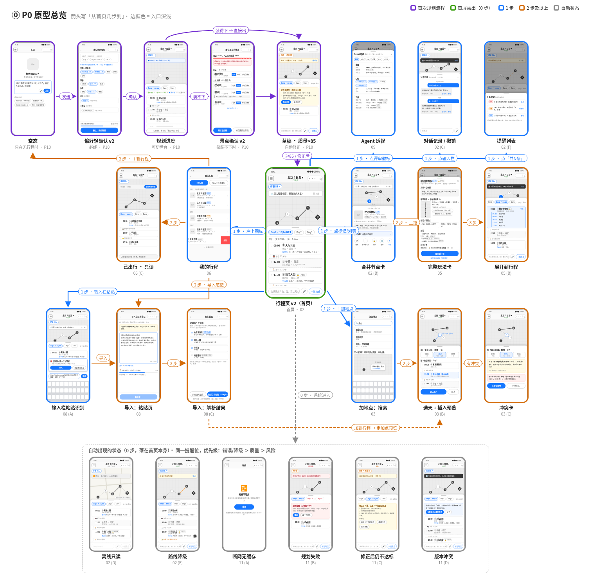
**P10_main_flow_1.png**

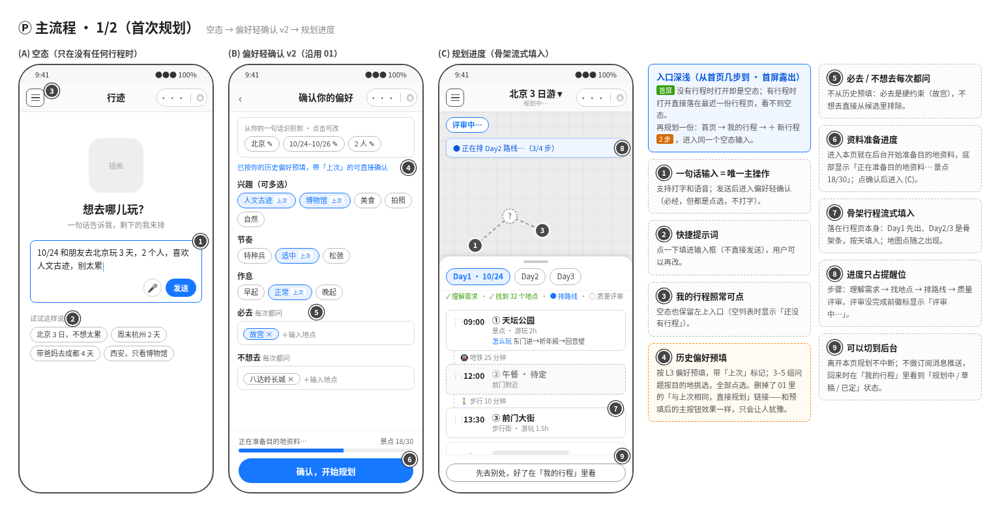
**P10_main_flow_2.png**

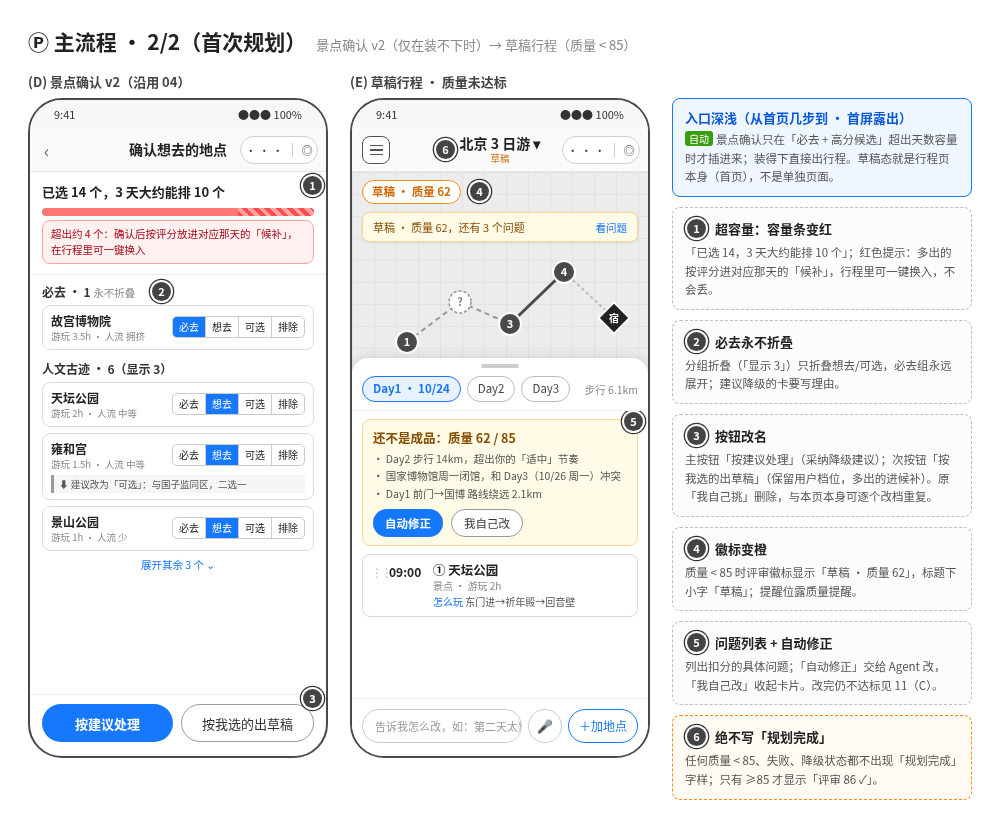
**02_itinerary_map_v2_1.png**

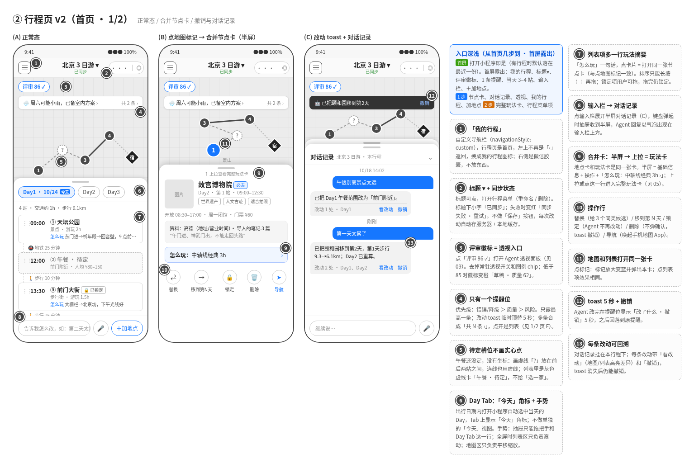
**02_itinerary_map_v2_2.png**

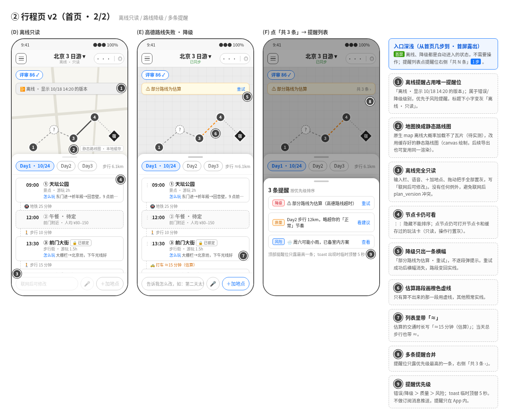
**03_add_place_v2.png**

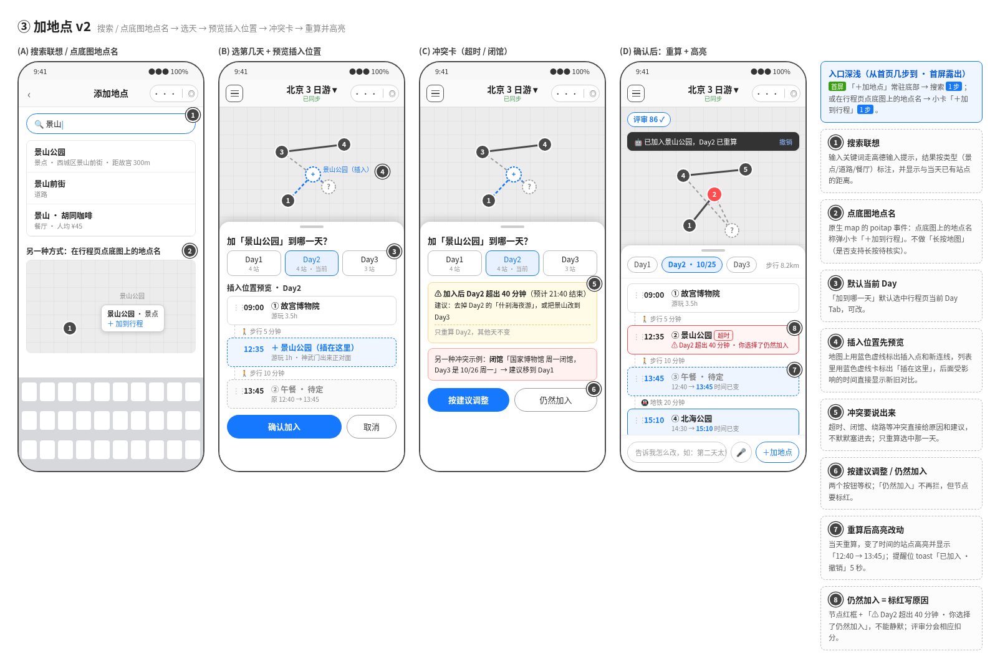
**05_play_card_v2.png**

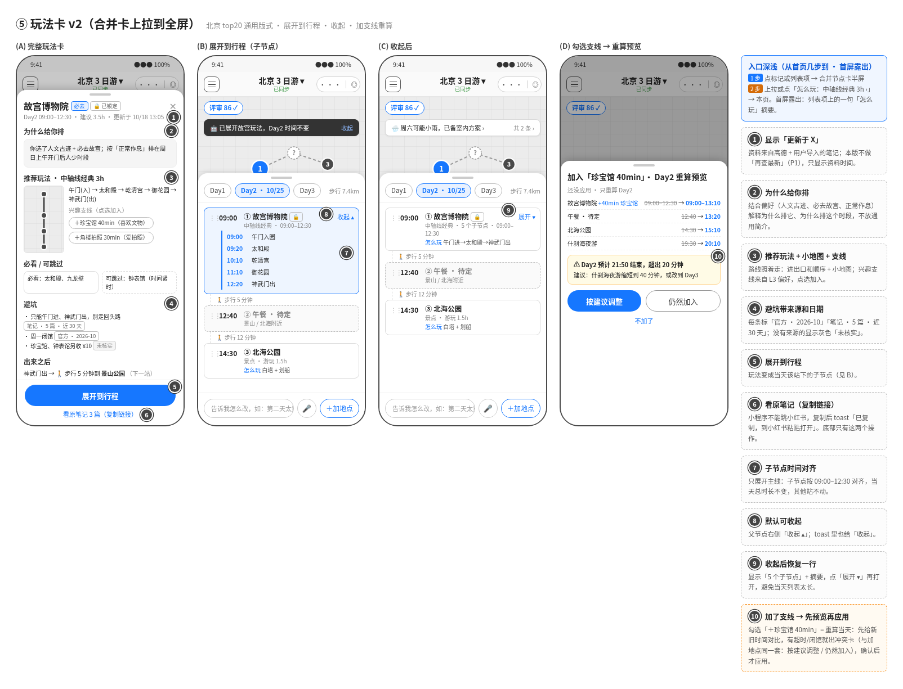
**06_my_trips.png**

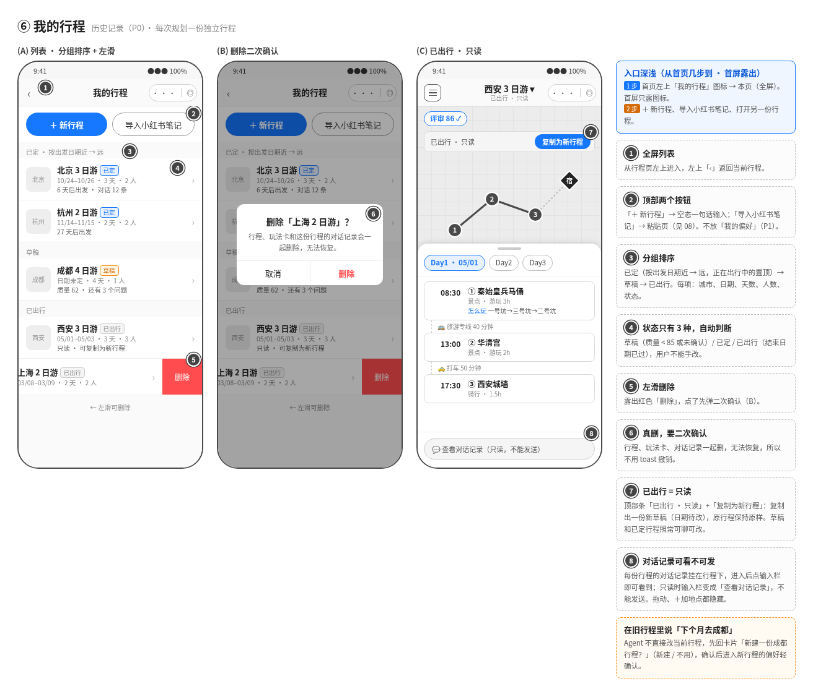
**08_xhs_import.png**

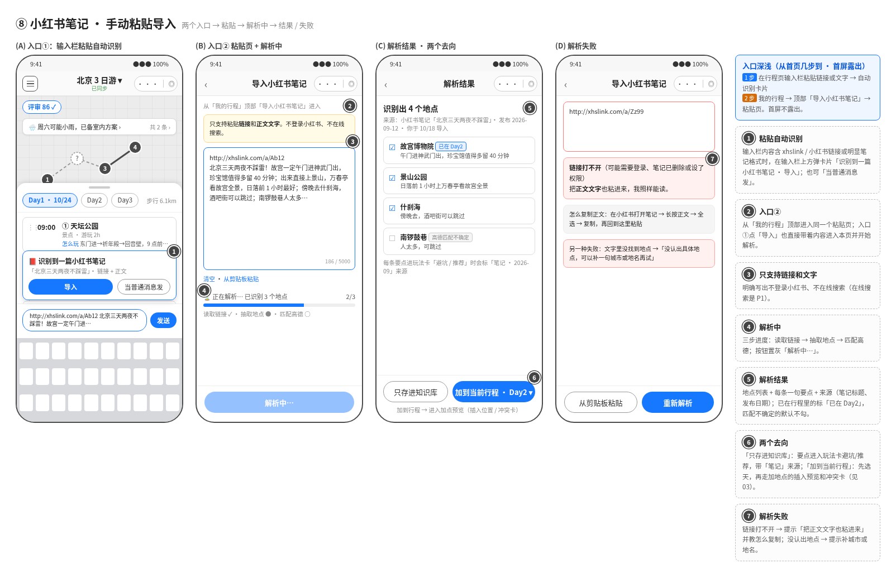
**09_agent_insight.png**

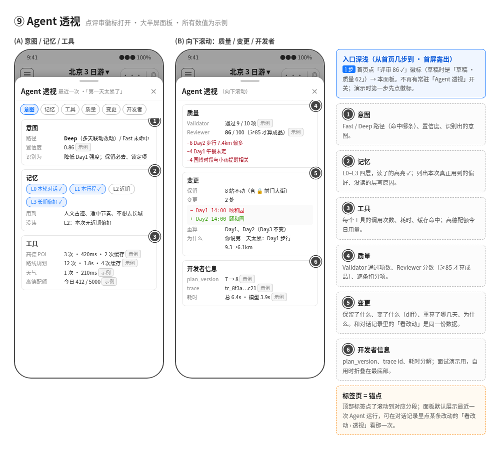
**11_error_states.png**

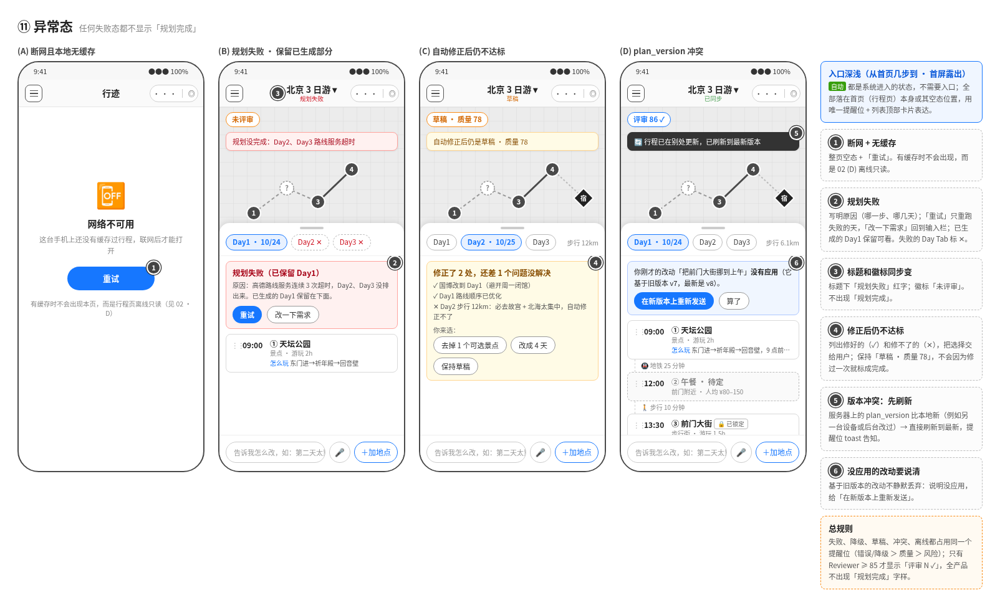

## 19. 来源
1. [微信 map 组件文档](https://developers.weixin.qq.com/miniprogram/dev/component/map.html)
2. [腾讯位置服务 小程序 FAQ（导航只能拉起外部地图 App）](https://lbs.qq.com/faq/miniprogramFaq/wxJsSdk)
3. [高德 开放平台基础服务计费说明（含个人认证配额 / QPS）](https://lbs.amap.com/pages/base_service_price)
4. [高德 FAQ：个人与企业认证开发者配额](https://developer.amap.com/faq/account/certification/39670)
5. [高德 地点搜索 2.0 文档（流量限制说明）](https://developer.amap.com/api/webservice/guide/api/newpoisearch)
6. [高德 路径规划 2.0 文档](https://developer.amap.com/api/webservice/guide/api/newroute)
7. [腾讯位置服务 配额说明（备选）](https://lbs.qq.com/dev/console/quotaImprove)
8. [博查 AI 开放平台](https://open.bochaai.com/)
9. [博查搜索 API 产品文档（含目录价）](https://netmarket.oss-cn-hangzhou.aliyuncs.com/fcc655779c6843a1b1a454da28b641b1.%E5%8D%9A%E6%9F%A5%E6%90%9C%E7%B4%A2api%E4%BA%A7%E5%93%81%E6%9C%8D%E5%8A%A1%E6%96%87%E6%A1%A3v1.0.2.pdf)
10. [小红书开放平台 Scope（仅 basic_info 已开放）](https://openaccount.xiaohongshu.com/docs/scope)
11. [阿里云开发者社区：小红书无公开笔记 API、爬取合规风险](https://developer.aliyun.com/article/1444472)
12. [Wikivoyage 再利用与许可（CC BY-SA 4.0）](https://en.wikivoyage.org/wiki/Wikivoyage:How_to_re-use_Wikivoyage_guides)
13. [中文 Wikivoyage 数据转储](https://dumps.wikimedia.org/zhwikivoyage/latest/)
14. [微信 网络文档（合法域名、HTTPS、跳过域名校验）](https://developers.weixin.qq.com/miniprogram/dev/framework/ability/network.html)
15. [web-view 文档（个人主体不支持）](https://developers.weixin.qq.com/miniprogram/dev/component/web-view.html)
16. [开放社区：海外地图空白需放大](https://developers.weixin.qq.com/community/develop/doc/00020cc10406c0c8cb41d31986ac00)
17. [Google Maps Platform 禁用地区（含中国）](https://cloud.google.com/maps-platform/terms/maps-prohibited-territories)
18. [wx.navigateToMiniProgram 官方文档（需用户点击、跳转前确认弹窗）](https://developers.weixin.qq.com/miniprogram/dev/api/navigate/wx.navigateToMiniProgram.html)
19. [开放社区：自 2020-04-24 起不需要跳转名单、不限数量；不同主体之间可以跳转](https://developers.weixin.qq.com/community/develop/doc/000ca87ad88f38f15ffa424555b000)
20. [故宫博物院 在线订票（7 日前 20:00 开售，只认官方小程序）](https://www.dpm.org.cn/subject_booking/)
21. [「故宫博物院」小程序页面](https://mp.weixin.qq.com/miniprogram/landing_page/YBIjracF-gK9t-1wtvy0zobY/zh_CN)
22. [中国国家博物馆 参观预约须知](https://pcticket.chnmuseum.cn/)
23. [国博 FAQ：「国家博物馆官方预约」小程序](https://www.chnmuseum.cn/cg/cjwt/202504/t20250403_271383.shtml)
24. [微信小程序平台运营规范（互推 / 集中跳转）](https://developers.weixin.qq.com/miniprogram/product/)
25. [wx.setStorage（单个 key 1MB，总共 10MB）](https://developers.weixin.qq.com/miniprogram/dev/api/storage/wx.setStorage.html)
26. [wx.saveImageToPhotosAlbum（需要 scope.writePhotosAlbum）](https://developers.weixin.qq.com/miniprogram/dev/api/media/image/wx.saveImageToPhotosAlbum.html)
