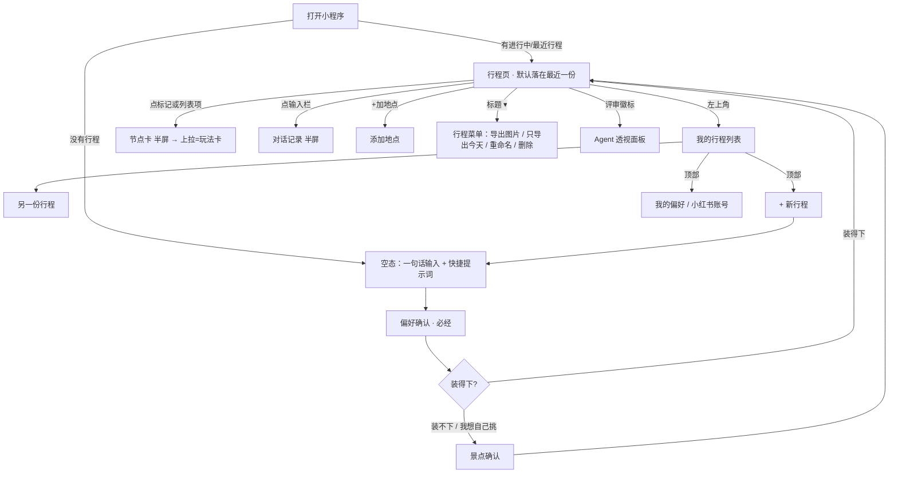

# 行迹 · UX 第一版意见（UX 设计师，2026-10-18）
依据：PRD_v2.md + 01–05 原型 + 今天新增的四条需求。标「待核实」的是平台能力，我没有实测过。

## 先说结论（5 条最要紧）
1. 地点卡（03）和玩法卡（05）是同一个节点的两张卡，从地图点和从列表点会打开不同的东西。要合并成一张卡：半屏显示基础信息和操作，上拉到全屏就是玩法卡。
2. 行程页地图上方叠了 4 层（评审徽标、透视开关、天气横幅、改动 toast），把 map 遮掉了大约三分之一，而且这些都得用 cover-view。规则定成：同一时间只有一个提醒位，toast 临时替换横幅，多条提醒合成「2 条提醒」。
3. 对话记录没有地方显示：输入栏只能输入，toast 消失以后就没法撤销，也看不到 Agent 改过什么。点输入栏要展开半屏的对话记录，每条改动都带「看改动 / 撤销」（新需求 4 里「对话挂在行程下」也要靠它）。
4. 离线时原生 map 加载不了瓦片（推断，要实测），所以「离线能看」不能只缓存数据。离线时地图位置换成缓存好的静态路线图，导出功能本来就要画这张图，可以复用。
5. 标了「已约」的节点要自动锁定日期和时段，不然 Agent 一重排，预约就作废了。

## (a) 信息架构与入口层级

| 目标 | 路径 | 点击数 | 首屏能看到什么 |
|---|---|---|---|
| 看当前行程 | 打开即是 | 0 | 地图 + Day Tab + 当天前 3–4 站 |
| 旅行中看今天 | 出行日期内自动选中今天的 Day | 0 | Day Tab 显示「今天」 |
| 改行程（对话） | 输入栏 | 1 | 输入栏常驻 |
| 看某站怎么玩 | 点节点 → 上拉 | 1–2 | 列表项上露一句玩法摘要（建议加） |
| 加地点 | +加地点 | 1 | 常驻 |
| 预约 | 节点上的「需预约」角标 → 卡片「去预约」 | 2 | 顶部提醒位 + 节点角标 |
| 切换 / 找旧行程 | 左上「我的行程」 | 1–2 | 只有图标 |
| 新建行程 | 我的行程 → + 新行程 | 2 | 不露出（低频，合理） |
| 导出 | 标题 ▾ → 导出 | 2 | 不露出；旅行日在 Day 区露「导出今天」 |
| 透视（演示） | 点评审徽标 | 1 | 徽标常驻 |
| 我的偏好 / 小红书登录 | 我的行程 → 顶部 | 2 | 不露出（低频） |

说明：行程页做成首页、用自定义导航栏（navigationStyle: custom），左上角给「我的行程」，右边是微信胶囊，不能放东西。现在 01–05 的左上角都是「‹」返回，行程页作为首页时没地方可返回，和「我的行程」入口冲突。

## (b) 现有原型的问题和改法
**02 行程页**
- 上方叠层太多（见结论 2）。「Agent 透视」开关不该常驻在自用界面上：改成点评审徽标打开透视面板，演示照样一步到位。图例 chip 可以删掉，形状学会以后就没用了。
- 「待选餐厅」还没选，没有坐标，但地图上已经画了 ② 号方块标记，和列表对不上。空槽位在地图上不画点，或画一个虚线「?」放在前后两站中间，连线也用虚线。
- 手势冲突：抽屉拖动、列表拖动排序、地图平移三种手势挤在一起。规则定成：抽屉只能拖顶部把手和 Day Tab 那一行；排序只能长按「⋮⋮」再拖；全屏状态下列表区只负责滚动。
- 锁定项能不能被用户拖动？PRD 说锁定是不让 Agent 动，没说用户能不能动。建议用户可以拖，拖完照样锁定，要在原型上写明。
- 改动 toast 带「撤销」，但要说清楚停留多久（建议 5 秒），消失以后在对话记录里还能撤销。
- 键盘弹起时抽屉收到半屏，Agent 的回复以气泡出现在输入栏上方，不要盖住整个列表。

**03 地点卡 / 添加地点**
- 和玩法卡合并（见结论 1）。半屏卡上加一行「怎么玩：中轴线 3h ›」，上拉进入完整玩法卡。
- 「也可以在地图上长按任意位置添加」：原生 map 有没有长按事件要核实（待核实）。PRD 写的是 bind:tap 和 bind:poitap，建议改成「点底图上的地点名称」。
- 「加到哪一天」默认选当前 Day Tab。「仍然加入」以后这个节点要标红并写明原因，不能静默。
- 删除不弹确认框，用 toast 撤销就行，少一次打断。

**04 景点确认**
- 「我自己挑」和本页本来就能逐个改档，两者意思重叠。改成主按钮「按建议处理」，次按钮「按我选的出草稿」。
- 漏洞：用户坚持选 14 个、超出容量时，Planner 怎么处理？建议容量条变红并提示「将有约 4 个想去的排不进，按评分自动放进候补」，候补放进「添加地点」面板。这条要 PM 定（见 d）。
- 分组折叠「显示 4」不能把「必去」折进去，必去永远展开。

**01 偏好确认**
- 「与上次相同，直接规划」和已经按 L3 预填好的主按钮效果几乎一样，只会让人犹豫。建议删掉，或者只在本次和上次偏好不同时出现。
- PRD 要求底部显示「正在准备目的地资料…」研究进度，原型里没画。

**05 玩法卡**
- 漏洞：勾选兴趣支线「+珍宝馆 40min」会让故宫超过 3.5 小时，但「展开到行程」又写着「整天时长不变」。规则要定：只展开主线时总时长不变；加了支线就重算当天，先给预览再应用，和加地点的冲突卡走同一套。
- 「再查最新」缺两个分支：小红书没登录 → 弹原生短信登录表单；遇到验证码 → 「本次跳过，用已有资料」。
- 「看原笔记（复制链接）」复制后给 toast「已复制，到小红书粘贴打开」。
- 展开后的子节点默认要能收起（原型右边已经有「收起」，保留），否则当天列表会变得很长。

## (c) 四条新需求的交互方案
**1. 攻略保存（P0）**
- 不做「保存」按钮。每次改动都已经走 apply-patch 存到服务器，用户只需要一个小状态：标题下方显示「已同步」或「同步失败 · 重试」。
- 本地缓存：每次打开或改动后，把当前行程和已打开过的玩法卡写进本地缓存。微信本地缓存单个小程序上限 10MB（官方 wx.setStorage 文档，可能已变化），只存最近 3 份行程就够了。
- 离线态：顶部提醒位显示「离线 · 显示 10/18 14:20 的版本」；地图换成静态路线图；输入栏、加地点、拖动排序都置灰，写明「联网后可修改」。离线不允许修改，避免恢复联网后 plan_version 冲突（要 PM 确认，见 d）。

**2. 导出图片**
- 入口：标题「北京 3 日游 ▾」→ 行程菜单 →「导出图片」；出行日在 Day 区额外露出「导出今天」。
- 流程：打开半屏「导出」面板 → 默认勾选「每天 1 张 + 重点玩法卡」，显示「共 5 张」→ 生成时显示进度「正在生成 2/5」→ 生成好后横向预览 → 「全部保存到相册」。
- 第一次保存要相册权限；用户拒绝过的话，引导到设置页重新打开（wx.openSetting）。
- 画图：map 组件不能截图，需要用 canvas 自己画小地图和路线（或用静态地图服务，具体实现交给开发）。生成的每日图同时作为离线时的静态地图，一份工作两处用。
- 每日卡版式：上面小地图加编号路线，下面是时间轴，每站一句玩法加一句避坑；待选餐厅显示「午餐待定」，不能留空；估算的交通时间带「≈」。

**3. 门票预约**
- 节点上加角标，三种状态：「需预约」橙色、「已约」绿色、「未核实」灰色（来源缺失时，沿用 PRD 的「未核实」）。
- 顶部提醒位：「故宫 10/17 20:00 开放预约 · 去预约」。只提醒还没约、并且 7 天内开放的那一条；多条时合成「3 个地点需预约」，点开是列表。
- 玩法卡里的「去预约」：能跳就直接拉起官方预约小程序（wx.navigateToMiniProgram 要用户点击触发；个人主体能不能用待核实）。跳不了的兜底：显示官方小程序的名称并复制，提示「在微信里搜索打开」。回来以后弹一句「约上了吗？」，给「已约 / 还没」两个按钮，选已约就补填时段（可选）。
- 标记已约以后自动锁定这个节点的日期和时段（结论 5）；如果用户在对话里要求挪动这一站，Agent 先提醒「故宫已约 10/24 上午，挪动要改签」。
- 只在打开小程序时提醒，体验偏弱；要不要用订阅消息在放票前推送，需要 PM 定（见 d）。

**4. 历史记录（P0）**
- 左上角「我的行程」图标 → 全屏列表；顶部是「+ 新行程」和「我的偏好」。
- 列表每项显示城市、日期、天数和状态；状态建议只用 4 个：「规划中」（还在生成或质量不到 85）、「待出发」、「旅行中」、「已结束」，按日期自动判断，不让用户手动改。
- 排序：旅行中的在最上面，然后是待出发（按日期从近到远），已结束的排最后。
- 点进去就是这份行程页，点输入栏就能看到这份行程的对话记录、接着聊。
- 左滑删除，删除前要二次确认（这里是真删，没有撤销）。
- 漏洞：在一份旧行程里说「下个月去成都」，Agent 不能直接改掉当前行程，要先回一张卡「新建一份成都行程？」。

## (d) 需要 PM 拍板的问题
1. 离线时只能看、不能改，可以吗？（我建议只读）
2. 「已约」是否自动锁定日期和时段？（我建议锁定）
3. 预约提醒要不要用订阅消息推送？要的话，个人主体能不能用订阅消息、能不能跳转其他小程序，请一起核实。
4. 已结束的行程还能接着聊、接着改吗，还是只能「复制为新行程」？（我建议改成「复制为新行程」，旧行程保持原样，方便以后回看）
5. 景点确认时用户坚持超出容量，系统是自动放进候补，还是不让继续？（我建议自动放进候补）
6. 地点卡和玩法卡合并成一张卡，可以吗？会影响 PRD 第 8 节的入口描述。
7. Agent 透视开关从常驻改成点评审徽标打开，演示脚本能接受吗？
8. 导出图片里重点景点的玩法卡选哪几个：只选「必去」，还是 Agent 自动挑游玩时长最长的 1–2 个？

## 下一步
上面的方向定下来以后，我再在这个文件夹里出新图：02 行程页 v2（导航栏、提醒位、合并后的节点卡、离线态）、06 我的行程、07 导出面板和每日卡版式。先出图的话，拍板以后很可能要返工。
