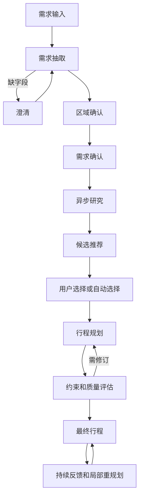
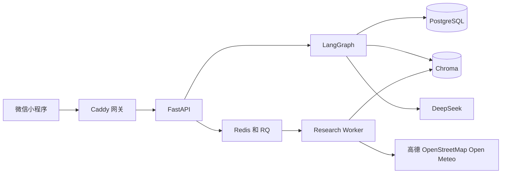

# 行迹微信小程序第二版技术与产品说明

版本 2.0  
编制日期 2026年10月18日  
适用范围 当前代码仓库 腾讯云部署和微信开发者工具验证版本

## 文档结论

第二版已经形成一条可运行的旅行规划闭环。用户在微信小程序中用自然语言描述需求，系统补齐关键信息、确认目的地区域、并行检索候选、让用户选择或自动选择，再生成逐日行程并完成规则校验、指标评估和复审。行程生成后，用户仍可继续提问或局部修改，系统会尽量保留未涉及的日期。

当前版本已在腾讯云真实运行，并在微信开发者工具中完成从需求输入到三日行程展示的端到端验证。云端数据服务和会话检查点具备持久化能力，国内地点、路线和天气已切换到高德 Web 服务。当前仍属于受控测试版本：服务器网关只监听回环地址，手机真机正式访问还需要 HTTPS 合法域名、微信登录、资源归属校验和发布审核；海外路线、签证、机票与酒店实时价格等能力尚未全部接入生产级数据源。

## 产品定位和设计目标

行迹是一款对话式旅行规划小程序。它不要求用户先填写复杂表单，而是把需求澄清、资料检索、候选筛选、行程生成和后续修改串成一段持续对话。第二版重点解决四类问题：让用户在手机界面完成完整流程；让规划数据来自真实地图和天气服务；让系统记住本次会话和跨会话偏好；让复杂反馈只修改必要范围，而不是每次推翻全部行程。

产品面向个人旅行者和小规模同行群体。当前支持目的地、日期、预算、人数、节奏、兴趣、体验偏好、饮食与其他限制的收集。系统输出候选体验、逐日活动、交通时间、预算提示、天气和风险提示，并保留来源和降级说明。

## 功能范围和状态

| 功能 | 当前状态 | 说明 |
|---|---|---|
| 多轮需求收集 | 已实现并验证 | 信息不完整时继续追问，已确认字段和缺失字段进入共享状态 |
| 目的地区域确认 | 已实现并验证 | 复杂目的地先确认城市或区域，防止同名地点和跨区域误匹配 |
| 候选地点研究 | 已实现并验证 | 国内使用高德地点搜索，海外可降级到 OpenStreetMap Photon 等公开服务 |
| 天气查询 | 已实现并验证 | 国内优先高德，海外及更长日期范围使用 Open Meteo 降级 |
| 路线规划 | 国内已验证 | 国内使用高德路线；海外普通高德 Key 可能返回服务范围限制，随后使用估算或待扩展降级 |
| 候选选择 | 已实现并验证 | 支持保留、删除、要求更多和系统自动选择 |
| 行程生成 | 已实现并验证 | 按日期生成活动、餐饮、交通与注意事项 |
| 规则和质量评估 | 已实现 | 包括硬约束、TripCraft 指标、Reviewer 和严格评估两级复审 |
| 局部重规划 | 已实现 | 识别日期、时段、活动和保留范围，只重建目标日期或目标部分 |
| 会话恢复 | 已实现 | 小程序保存 session ID 和 user ID，后端使用 PostgreSQL 检查点恢复 |
| 长期记忆 | 已实现 | 工作记忆、旅行经历和用户画像分层存储并按意图选择读取 |
| RAG 攻略检索 | 已实现 | Chroma 中的攻略、经历、画像通过五路检索、融合和重排进入研究上下文 |
| Agent Reach 和小红书 | 接口已保留 | 云端基础镜像缺少相应 CLI 或登录态时明确返回不可用，不伪造结果 |
| 签证信息 | 占位 | 当前为规则或 mock 数据，未接入权威签证 API |
| 机票价格 | 估算 | 当前没有实时机票搜索 API |
| 酒店实时价格 | 部分能力 | 候选和选择流程已存在，实时库存和成交价格未形成完整闭环 |
| 微信真机公网发布 | 尚未完成 | 需要合法 HTTPS 域名、微信身份鉴权、资源归属校验和小程序审核 |

## 小程序功能设计

### 页面结构

第二版将主界面改为雾蓝背景、深海军蓝主色、白色悬浮卡片、大圆角和柔和阴影。首页包含旅行主题主视觉、快捷需求入口、对话区、候选区和行程区。底部和页内标签让用户在对话、候选与行程之间切换。阶段标签显示系统正在收集需求、研究、等待选择、规划或完成。

小程序保存当前 session ID 和 user ID。用户重新打开页面时会拉取云端会话快照；点击新建行程时生成新的会话标识。聊天消息、需求摘要、研究进度、候选分组、逐日行程和警告信息都由后端状态驱动，而不是在前端伪造。

### 核心用户流程

1. 用户输入目的地和旅行想法，或点击快捷提示词。
2. Requirement Agent 增量提取需求。若缺少日期、人数或其他必要信息，图在澄清节点暂停。
3. 对复杂或多区域目的地，系统要求用户确认实际游览区域。
4. 用户确认需求后，系统构建约束并把研究任务放入 Redis 队列。
5. Worker 并行调用地点、天气、路线、攻略、签证和酒店等工具。小程序轮询研究状态并展示进度。
6. 系统按景点、餐饮和特色体验组织候选。用户可选择、删除、要求更多，或让系统根据偏好自动选择。
7. Planner 生成逐日行程。Validator、TripCraft 指标、Reviewer 和严格评估决定是否修改后再输出。
8. 行程完成后进入持续反馈状态。天气等旁路问题不会破坏当前行程；修改请求由意图识别和执行路由决定是否研究或局部重规划。

## 系统总体架构

系统由微信小程序、Web 网关、FastAPI、LangGraph、RQ Worker、PostgreSQL、Redis 和 Chroma 组成。网关把 API 请求转发到 FastAPI。API 负责会话接入、状态快照和任务状态；LangGraph 编排业务节点；RQ Worker 处理耗时研究；PostgreSQL保存图检查点和业务记录；Redis保存队列、任务运行信息和短期工作记忆；Chroma保存攻略、旅行经历和画像语句的向量索引。

### 云端部署

当前腾讯云实例为 Ubuntu 24.04 x86_64，4 核 CPU，约 3.6 GiB 内存、1.9 GiB Swap 和约 26 GiB 可用磁盘。Docker 29.1.3 和 Compose 2.40.3 已安装。六个容器分别为 api、worker、postgres、redis、chroma 和 gateway。

PostgreSQL、Redis 和 Chroma 不映射宿主机端口。gateway 只映射到 `127.0.0.1:8080`，公网只允许 SSH 22，80 端口被 UFW 阻断。当前微信开发者工具通过本地 SSH 隧道访问 `http://127.0.0.1:8000`。这一结构适合开发验证，但不等于微信真机生产网络结构。

Compose 为各服务设置了内存和 CPU 上限，日志使用轮转。空闲时六个容器约占 313 MiB；完整规划期间观测到的六容器峰值约 457 MiB，主机可用内存约 2.2 GiB，Swap 未被使用。

## API 设计

### 对话和会话 API

| 方法和路径 | 用途 | 主要输入 | 主要输出 |
|---|---|---|---|
| `POST /chat` | 同步推进一次对话 | session_id message user_id | response current_node need_user_input data |
| `POST /api/chat/stream` | 以 SSE 输出同步节点的模型 token | 与 chat 相同 | token final error 等 SSE 事件 |
| `GET /api/research/status` | 查询后台研究状态 | session_id | idle queued running done error 和各工具进度 |
| `GET /api/session/{session_id}` | 只读恢复当前会话状态 | 路径参数 | 当前回复 节点 阶段 需求 候选 行程等 |
| `GET /health` | 进程存活检查 | 无 | 基础健康状态 |
| `GET /health/ready` | 依赖就绪检查 | 无 | PostgreSQL Redis Chroma 状态 |

`ChatRequest` 包含 `session_id`、自然语言 `message` 和可选 `user_id`。未提供 user_id 时使用 session_id 作为记忆隔离键。`ChatResponse.data` 只暴露当前阶段需要的状态切片，例如需求、候选、已选地点、行程、评审结果或反馈意图，避免把全部内部状态返回给客户端。

### 行程工作区 API

| 方法和路径 | 用途 |
|---|---|
| `GET /trips/{trip_id}/days` | 获取行程日期列表 |
| `GET /trips/{trip_id}/days/{day_id}` | 获取单日计划 |
| `GET /places/autocomplete` | 地点联想 |
| `GET /places/{place_id}` | 地点详情 |
| `POST /trips/{trip_id}/days/{day_id}/preview-insert` | 预览插入地点后的单日变化 |
| `POST /trips/{trip_id}/days/{day_id}/insert-poi` | 插入地点的兼容入口 |
| `POST /trips/{trip_id}/apply-patch` | 用乐观锁应用计划补丁 |
| `POST /trips/{trip_id}/rollback-patch` | 回滚计划补丁 |
| `GET /trips/{trip_id}/hotel-candidates` | 获取按城市组织的酒店候选 |
| `POST /trips/{trip_id}/hotels/select` | 选择酒店 |
| `POST /trips/{trip_id}/hotels/use-recommended` | 使用推荐酒店 |
| `GET /trips/{trip_id}/days/{day_id}/routes` | 获取单日路线信息 |

工作区使用 `plan_version` 做数据库乐观锁。客户端在应用补丁时必须携带预期版本；版本不一致时拒绝覆盖，防止多个修改把新计划覆盖成旧计划。

## LangGraph 工作流

LangGraph 使用一个 JSON 可序列化的 `AgentState` 作为共享状态。核心字段包括会话历史、旅行需求、目的地评估、研究结果、候选、已选地点、行程、约束、评估报告、最终计划、意图结果、聚合结果和记忆上下文。生产环境使用 PostgreSQL Checkpointer；未配置数据库且允许降级时才使用内存 Checkpointer。

### 节点和暂停点

主图包含需求、澄清、区域确认、用户确认、研究、推荐、用户选择、规划、验证、指标评估、约束放宽、复审、严格评估、最终输出和计划后反馈等节点。`clarification`、`region_confirmation`、`user_confirmation`、`user_selection` 和 `post_plan_feedback` 是需要用户新消息的暂停点。`research_orchestrator` 也是暂停点，但由后台 Worker 恢复，不要求用户再次输入。

规划阶段的主要路由如下：Planner 先判断候选覆盖是否足够，不足时触发定向增量研究；可行后进入 Validator 和 TripCraft 指标；必要时 Planner 修订；Reviewer 达标后进入严格评估；严格评估达标或耗尽修订预算后生成最终输出。快速 Reviewer 默认通过线为 85 分，严格评估另有独立修订计数和阈值。

### Human in the loop

人工确认不是另起一套流程，而是由 `interrupt_before` 暂停同一个图。API 在暂停状态读取 `need_user_input` 和 `pending_response`，把问题返回给小程序。下一条消息通过 `update_state` 写回原 thread_id，随后继续执行。这保证了需求确认、候选选择和计划后反馈共享同一会话状态。

## 四个 Agent 的职责

| Agent | 输入 | 核心职责 | 输出 |
|---|---|---|---|
| Requirement Agent | 用户消息 会话历史 用户画像 | 增量抽取需求 合并字段 识别缺失项 应用画像提示 | TravelRequirement 摘要和待确认问题 |
| Research Orchestrator | 已确认需求 记忆上下文 研究模式 | 生成查询 并行调用工具 执行 RAG 检索 去重和分组 | ResearchResult 和候选证据 |
| Planner Agent | 需求 已选地点 路线 天气 约束 历史计划 | 生成逐日安排 估算时间和成本 执行局部重规划 | Itinerary 和可行性信息 |
| Reviewer Agent | 行程 需求 规则问题 | 五维快速打分 生成可执行的修订意见 | ReviewReport |

意图解析、记忆管理、检索器、执行计划器和结果聚合器是服务或图节点，不计作第五个 Agent。这样既保持职责清晰，也避免把每个算法模块都包装成自治 Agent。

所有 Agent 通过统一 `get_llm` 工厂获取模型。配置 DeepSeek Key 时默认使用 `deepseek-chat`。`deepseek-reasoner` 仅作为预留深度档，不用于当前结构化函数调用，因为其延迟和工具调用兼容性不适合本项目。DeepSeek 不可用时可回退 Kimi；均不可用时部分节点采用规则或启发式降级。密钥只存服务器 `.env`，不进入代码和本文档。

## 意图识别设计

计划完成后的自由文本首先进入 `MultiSignalIntentInterpreter`。系统把简单、高置信请求走 Fast Path；复杂、歧义或低置信请求走 Deep Path。

Fast Path 使用规则解析和工作流状态，不发起网络调用。规则会提取操作类型、目标日期、时段、数量、区域替换、活动类别、否定信息和保留范围。只有通过置信度和工作流有效性检查才直接返回。

Deep Path 复用规则结果，同时并行执行本地相似度检索和 LLM 结构化解析。本地检索使用字符 n gram 向量与余弦相似度，在 `intent_data` 样本库中查找相近意图，不依赖外部 Embedding API。LLM 分支失败或超时不会阻断结果；融合器按实际到场信号重新归一化权重。

默认融合权重为 LLM 0.60、本地相似度 0.25、规则 0.15。一致性奖励为 0.08，工作流无效惩罚为 0.50，歧义惩罚为 0.20。高置信阈值为 0.82，中置信阈值为 0.65，Fast Path 门槛为 0.75。Embedding 和 LLM 分支超时分别为 3 秒和 45 秒。

`IntentResult` 描述 task_type、primary_intent、operation、target、实体、状态补丁、是否需要研究、是否需要重规划、下一步 Agent 和澄清问题。Workflow Validator 会检查被引用的日期和活动是否存在、是否触碰锁定约束以及是否属于旁路查询。Execution Planner 再把意图转换成具体调用序列，Agent Router 执行后由 Result Aggregator 合并、去重、检测冲突并生成保留与变更差异。

## RAG 设计

### 数据摄取

攻略数据经过文档加载、清洗、目的地规范化、元数据提取、语义分块和向量写入。默认目标块约 400 token，最大 650 token，相邻块重叠 80 token。写入使用稳定 ID 和内容哈希，因此重复导入不会反复增加记录。

当前 Chroma 三个逻辑集合为 `travel_guides`、`episodic_memory` 和 `user_profile`。已完成迁移验证的计数为 8 个来源、307 个攻略块和 4 个相关索引记录；重复导入后计数不变。

### 检索路由

Source Decider 先决定 `NO_RETRIEVAL`、`MEMORY_ONLY`、`RAG_ONLY`、`WEB_ONLY` 或 `RAG_AND_WEB`。寒暄不检索；询问自己过去偏好时只读记忆；攻略、体验和避坑偏向 RAG；天气、票价、营业时间和签证政策偏向实时工具；同时出现主观攻略与强时效信息时两路并用。

### 五路检索和融合

系统并行运行 dense、keyword、metadata、episodic 和 profile 五个检索器。每一路经过统一 Tool Manager，获得超时、缓存、熔断和失败隔离。默认 dense top k 为 20，重排 top k 为 8，最终上下文最多 6 个块。

融合分数默认权重为 dense 0.45、keyword 0.20、metadata 0.15、source quality 0.10 和 freshness 0.10。Result Merger 合并同一 chunk 的多路分数，移除近似重复并限制同一父文档的占比。Reranker 可使用 LLM，也可使用启发式重排。Context Assembler 最终生成 USER PROFILE、EPISODIC MEMORY、TRAVEL GUIDE 和 LIVE WEB 四类上下文；出现具体时间或价格时会标记必须实时核验。

Chroma 正常时使用 ONNX MiniLM 向量。模型不可用时可使用确定性的哈希向量降级，以保留测试和基本召回能力，但语义质量低于真实向量模型。

## 记忆设计

第二版使用分层记忆，避免把所有历史内容无差别塞进模型上下文。

| 层级 | 内容 | 存储 | 生命周期和用途 |
|---|---|---|---|
| L0 工作状态 | 当前图状态 对话历史 候选 行程 | PostgreSQL LangGraph checkpoint | 当前会话的权威执行状态 |
| L1 工作记忆 | 最近消息 当前需求 当前阶段 | Redis，内存降级 | 默认保存最近 12 条，TTL 24 小时 |
| L2 情景记忆 | 已完成旅行 选择 拒绝项 反馈和结果 | PostgreSQL JSON 账本加 Chroma 向量 | 跨会话查找相似旅行和避免重复推荐 |
| L3 用户画像 | 节奏 兴趣 餐饮 酒店和交通偏好 | PostgreSQL JSON 加 Chroma 语句索引 | 跨会话个性化 |

Memory Context Builder 按意图选择读取层级。天气旁路只需要工作记忆；重规划和反馈读取工作、情景和画像；新旅行主要读取情景和画像。这样可以控制延迟和提示词长度。

画像不是一次写入后永久相信。每个偏好语句带 confidence、evidence_count 和 status。新偏好先是 `TENTATIVE_PROFILE`，同一维度得到三次证据后升级为 `STABLE_PROFILE`。同维度冲突时稳定画像优先。情景记忆始终写入 PostgreSQL 事实账本；重要度达到 0.3 时再写入 Chroma，以支持语义召回。Worker 重试通过稳定内容哈希保持幂等。

## 地图天气和外部工具

### 高德替换

第二版已把原 Google 地图配置改为高德 Web 服务。国内地点查询使用高德地点搜索 2.0，路线使用高德路线规划，天气使用高德天气。前端若需要地图 JS 能力，使用独立的 JS API Key 和安全密钥；后端 Web Service Key 不下发到小程序。

为适应高德配额，地点请求加入每秒 2 次的限速器。初始检索每个标签只发一个主查询并带目的地区域签名，每个区域最多保留 10 个结果，取消批量逐地点详情调用。架构、摄影等主题限定为旅游景点类型，减少商场、培训机构等无关结果。区域校验会拒绝名称相似但行政区域不一致的结果。

最新本地配额验证以 4 个并发逻辑查询获得 10 条结果，覆盖建筑、文化、美食和地标，未出现限流错误。最近一次发布后日志中的高德 QPS 错误为 0。

### 海外降级

海外地点可以使用 Photon 或 OpenStreetMap 公开数据，天气使用 Open Meteo。东京地点和天气已验证可返回结果。高德东京路线会返回服务范围限制，因此海外路线当前只能使用估算或后续接入其他路线服务，不能宣称与国内路线完全等价。

### 攻略和社交内容

Agent Reach 和 `opencli` 小红书搜索接口已保留。它们依赖额外 CLI、网络环境或浏览器登录态。当前云端容器没有可用的小红书登录态，因此失败时返回明确状态和安装提示，不把空结果包装成真实搜索。

## 规划和质量控制

Planner 使用确定性排程作为主体：根据营业时间、建议停留时间、交通时间、用餐时段、每日最晚返回时间、节奏和预算组织活动。LLM 主要用于需求理解、受约束的理由文案和评审，不允许补造地图工具没有返回的评分、票价或营业时间。

第一层 Validator 检查时间冲突、预算、重复景点、每天数量和最晚返回时间。TripCraft Metric Evaluator 对行程进行更细的约束和质量评分，并保留历史最佳方案。Reviewer 使用五个维度快速检查并给出修订意见；随后严格评估结合完整需求、记忆和研究证据做第二道检查。两个循环使用独立计数，避免一个循环耗尽后跳过另一个检查。

当前一次真实完整计划的质量评分约为 49 分，说明系统闭环已经可运行，但候选相关性、路线降级和行程细节仍需优化。这一分数不应被写成生产质量达标。后续应建立固定的黄金案例集，对目的地覆盖、路线真实性、预算误差、时间冲突和用户偏好命中率持续回归。

## 异步任务和失败恢复

研究任务由 API 创建后进入 Redis RQ 队列，Worker 更新 PostgreSQL `task_runs`。任务状态为 queued、running、done 或 error，并保存工具进度、尝试次数、错误和完成时间。相同 session 和 checkpoint 生成稳定 task key，避免重复派发。

失败任务可在最大尝试次数内重新入队。超过时间仍处于 queued 或 running 的任务会标记为 error，错误信息指出 Worker 可能中断或超时。Worker 健康检查已经从精确匹配一个 Worker 改为匹配至少一个 Worker，避免 Redis 暂留旧注册信息时产生假不健康。

已观察到 API 容器长时间运行后曾出现 unhealthy 并导致网关 502，重启后恢复。当前尚未形成确定根因，因此在正式发布前应增加连续运行监控、容器日志告警和复现测试，不能把一次重启恢复视为根因已解决。

## 数据持久化设计

PostgreSQL 保存 `workspace_states`、`users`、`sessions`、`task_runs`、`user_profiles` 和 `trip_episodes`。LangGraph 自身的 checkpoint 表由 PostgreSQL Checkpointer 管理。Redis 使用 AOF 保存队列和工作记忆。Chroma 数据目录挂载到持久卷。

发布使用 `/opt/travel-agent/current` 指向版本目录，运行数据通过独立 runtime 目录复用。PostgreSQL、Redis、Chroma 和 API 重启后，健康状态与数据均已验证正常。验证时用户画像 10 条、旅行经历 14 条、会话 2 条；早期迁移基线为画像 9 条和旅行经历 13 条，新增记录来自验证会话而非重复导入。

## 第二版主要修改记录

| 领域 | 修改内容 | 结果 |
|---|---|---|
| 小程序界面 | 改为雾蓝背景、海军蓝主色、白色浮层、大圆角、软阴影和旅行主视觉 | 更接近用户提供的旅行套件参考图 |
| 小程序交互 | 增加快捷提示、阶段标签、候选分组、行程时间线、新建会话和恢复会话 | 微信开发者工具完成全流程 |
| 地图服务 | Google 配置替换为高德 Web 服务，增加地点、路线和天气适配器 | 国内真实地图链路可用 |
| 海外能力 | 加入 OpenStreetMap Photon 和 Open Meteo 降级 | 海外地点和天气可用，路线仍有限制 |
| 配额控制 | 高德请求限制为每秒 2 次，减少查询数量和逐地点详情请求 | 最近发布后未出现 QPS 错误 |
| 搜索质量 | 查询显式携带目的地，增加行政区域校验和旅游类型限制 | 降低跨城市和无关商业结果 |
| 自动选择 | 优先用户兴趣和区域覆盖，抑制未请求的购物、夜生活和音乐，正餐优先于咖啡馆 | 候选更贴合需求 |
| LangGraph | 增加区域确认、约束构建、TripCraft 指标、严格评估和计划后反馈闭环 | 从一次生成升级为可持续修改的状态机 |
| 意图识别 | 增加 Fast Path、Deep Path、规则、本地相似度、LLM 融合和工作流校验 | 支持复杂反馈和局部重规划 |
| RAG | 增加数据摄取、五路并行检索、融合、重排和上下文组装 | 攻略、历史和画像可共同参与研究 |
| 记忆 | 增加工作、情景、画像分层，画像置信度状态机和按意图读取 | 支持跨会话个性化并控制上下文成本 |
| 后台执行 | 研究从 API 同步阻塞改为 RQ Worker，增加状态轮询、重试和陈旧任务处理 | 请求可快速返回研究中状态 |
| 持久化 | 引入 PostgreSQL 业务表和 LangGraph PostgreSQL Checkpointer | 会话、任务、画像和经历可重启恢复 |
| 健康检查 | 就绪检查覆盖 PostgreSQL、Redis、Chroma；修复 Worker 数量误判 | 部署诊断更可靠 |
| 安全边界 | 数据服务不暴露宿主机端口，网关仅回环监听，密钥留在服务器环境变量 | 适合隧道测试，尚未开放公网 |
| 打包 | 排除密钥、运行数据、虚拟环境、node_modules、备份和 output | 降低交付包泄密和膨胀风险 |

## 验证结果

后端完整测试曾达到 336 项通过；最新高德 QPS 调整后的目标测试为 23 项通过。前端 7 项测试通过，生产构建通过。微信开发者工具完成了需求输入、澄清、区域确认、研究、候选选择、自动规划和三日行程展示。`/health/ready` 返回 PostgreSQL、Redis 和 Chroma 全部 `ok`。

这些结果证明当前版本具备演示和继续开发基础，但不能替代真机网络、微信审核、长期稳定性和安全测试。正式发布还需在固定构建上重新执行完整后端回归，并补充真机弱网、并发、鉴权和越权测试。

## 安全和隐私

服务端密钥必须只存在 `.env` 或云端密钥服务，不得写入小程序包、Git 仓库、说明文档或日志。前端只使用允许公开的高德 JS Key；Web Service Key 和 DeepSeek Key只在后端使用。

当前 API 没有完整的微信登录态校验，也没有证明 session_id、trip_id 与当前微信用户绑定。若直接开放公网，攻击者可能猜测或复用标识访问他人状态。因此上线前必须实现 `wx.login` code 换取 openid 或 unionid、签发后端会话、对每个资源做 ownership 检查、限制 CORS、设置请求频率限制并清理敏感日志。

用户画像和旅行历史属于个人数据。产品需要提供清除会话、删除画像和删除旅行历史的入口，并明确保存期限。地图、模型和外部搜索调用只发送完成任务所需的最小信息。

## 已知限制和风险

1. 服务器位于上海并且公网 80 被阻断。当前隧道方案只适合开发者工具，电脑关闭后本地隧道也会停止。
2. 微信真机要求 HTTPS 合法域名和平台配置，不能使用 `127.0.0.1` 访问远端服务。
3. 尚未实现正式的微信身份鉴权和资源归属校验，因此不应直接把 API 暴露到公网。
4. 海外地点与天气已有降级，海外公共交通和驾车路线尚未达到国内高德链路的真实性。
5. 签证、机票和酒店价格不应作为可下单的实时结果；当前只能显示估算或未接入提示。
6. 小红书和 Agent Reach 在云端缺少 CLI 或登录态时不可用。
7. API 长时间运行曾出现不健康，需要持续运行压测和监控定位。
8. 单次计划质量评分仍低于目标，候选排序、路线和约束修复需要继续优化。

## 正式发布前的实施清单

### 必须完成

- 绑定无需新增付费资源的现有域名或可用 HTTPS 域名，并在腾讯云和微信公众平台完成备案及合法域名配置。
- 实现微信登录、后端会话签发、资源 ownership 校验和注销流程。
- 把 Caddy 从回环测试配置调整为 HTTPS 入口，同时保持数据库、Redis 和 Chroma 仅内网可达。
- 在固定发布版本执行全量测试、真机端到端测试、弱网测试和多用户越权测试。
- 增加 API 和 Worker 的运行监控、错误告警、备份和恢复演练。
- 明确签证、机票、酒店和海外路线的产品文案，未接入时不可展示为实时事实。

### 建议优化

- 为候选和最终行程建立人工标注评测集，持续调整搜索词、排序和评分阈值。
- 接入适合海外路线的服务，统一交通时间和跨城市移动模型。
- 为 Agent Reach 和小红书设计合规、可维护的云端数据来源，不依赖个人浏览器登录态。
- 增加用户可见的记忆管理页面和来源说明。
- 在小程序中补充骨架屏、失败重试、离线提示、行程分享和导出能力。

## 配置和目录索引

关键代码目录如下：

- `miniprogram` 保存微信小程序页面、样式、配置和 API 封装。
- `travel_agent/api` 保存对话、SSE、会话和工作区 API。
- `travel_agent/graph` 保存 AgentState、节点和 LangGraph 工作流。
- `travel_agent/agents` 保存四个 Agent 的实现。
- `travel_agent/intent` 保存多信号意图识别。
- `travel_agent/rag` 保存摄取、检索、融合、重排和 Chroma 客户端。
- `travel_agent/memory` 保存工作、情景、画像和上下文构建。
- `travel_agent/execution` 保存研究任务、执行计划、路由和结果聚合。
- `travel_agent/evaluation` 保存约束、TripCraft 指标、Reviewer 和严格评估。
- `travel_agent/tools` 保存高德、天气、路线、攻略和其他外部工具适配器。
- `travel_agent/persistence` 保存 PostgreSQL 业务表访问。
- `config` 保存意图、RAG、记忆、评估和工具运行参数。
- `compose.yaml` 和 `deploy` 保存容器与网关部署配置。

生产环境至少需要配置 PostgreSQL、Redis、Chroma、DeepSeek 和高德 Web Service 相关变量。所有 Key 在本文档中均使用变量名表示，不记录真实值。

## 版本判断

第二版已经从本地原型升级为云端持久化、可通过微信开发者工具完整操作的旅行规划系统。它可以作为产品演示版、受控测试版和后续发布基础。要达到用户关闭电脑后仍能在微信真机直接使用的目标，下一阶段的重点不是继续增加 Agent 数量，而是完成 HTTPS 域名、微信身份鉴权、资源隔离、长期稳定性和真实数据源闭环。
